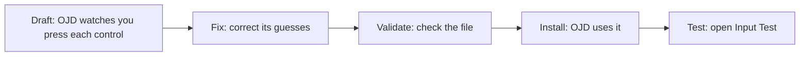

# Start: Add Support for a Controller

Teach OJD a controller it does not know.

If your controller is missing from [Supported Controllers](Supported-Controllers.md), OJD can't tell which button you pressed. You'll make a controller record, a small file that works like a phrase book: in Terminal, with the controller connected, let OJD watch you press each control, fix its guesses, then install the file.

## Before You Begin

Check [Supported Controllers](Supported-Controllers.md) first. Then install OJD and connect the controller. See [Start: Play a Game with a Controller](Start-Play-a-Game.md). This page uses Terminal.

A record is a small file that describes what a controller sends. It works like a phrase book: it tells OJD what each message from the controller means, such as "byte 3 is the A button".

## Add a Record

1. Run `ojd service start`.
2. Run `ojd controller list` to find the controller's ID. See [Finding Your Controller ID](Connecting-Controllers.md#finding-your-controller-id).
3. Run `ojd record draft CONTROLLER > record.plist`. If the controller is in the SDL database, add `--from-sdl` and skip the next step.
4. For the next 10 seconds, press every button and move every stick, trigger, and the D-pad. OJD watches what changes and writes a first guess of the record.
5. Fix what the guess got wrong in `record.plist`. See [Draft a Record from a Connected Controller](Controller-Records.md#draft-a-record-from-a-connected-controller).
6. Run `ojd record validate record.plist` to check the file.
7. Run `ojd record install record.plist`.
8. Click **Controllers**, select the controller, and click **Open Input Test**. Each press should light up the matching control.

   

Run `ojd record list` to see which records apply. Run `ojd record remove VVVV:PPPP` to remove yours.

## Share the Result

Your record helps the next person with the same controller. See [Reporting a Bug](Reporting-a-Bug.md) and [Writing Controller Mods](Writing-Controller-Mods.md).

## Further Reading

- [Controller Records](Controller-Records.md)
- [Testing a Controller](Testing-a-Controller.md)
- [Supported Controllers](Supported-Controllers.md)
