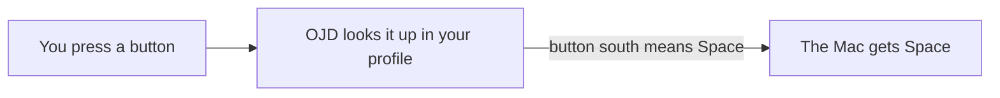
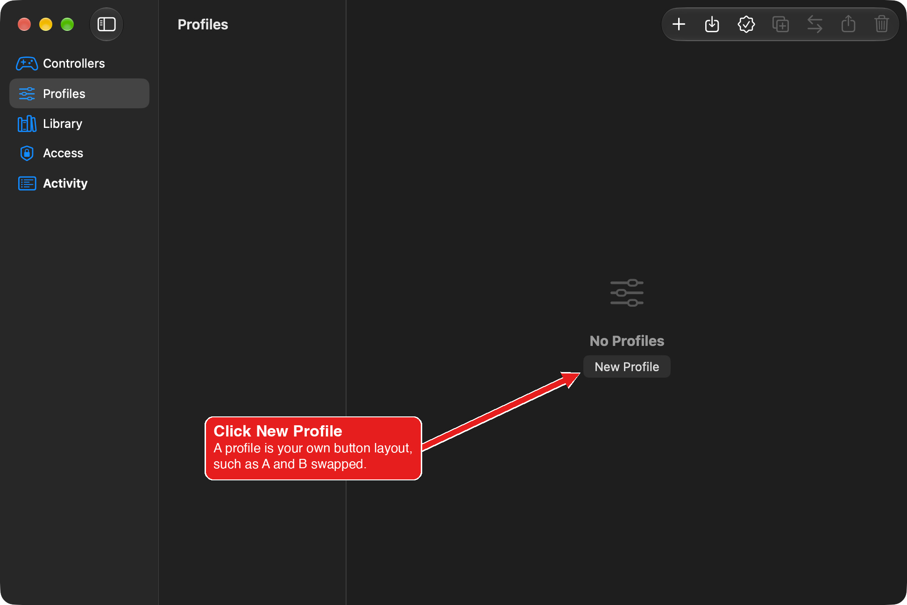
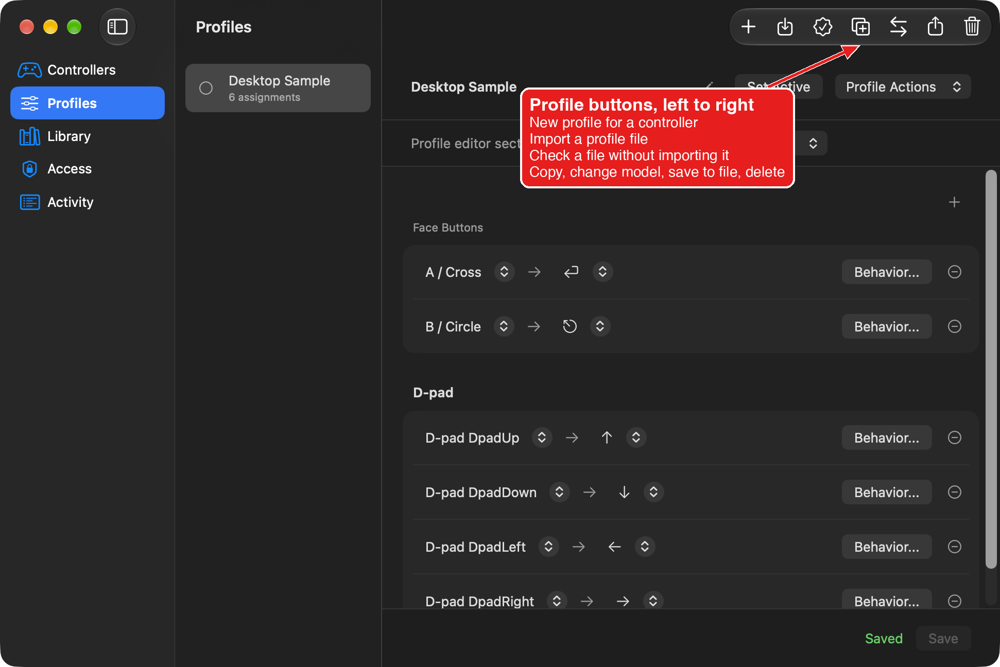

# Start: Control the Mac with a Controller

Make controller buttons press keys, click, move the pointer, or scroll.

This helps from the couch, or in an app with no controller support. In the **Profiles** area, create a [profile](Glossary.md#terms), a list that says "this button means that key", then pick a key for each button.



## Before You Begin

Install OJD and connect the controller. See [Start: Play a Game with a Controller](Start-Play-a-Game.md). Allow **Accessibility** (**Device Control and Data Access** on macOS 27) by clicking its **Permission Missing** row in the menu-bar menu.

## Make a Profile in the App

A profile holds what each control does.

1. Click **Profiles**, then **New Profile**.

   
2. Enter a **Profile name**, choose your **Controller** and **Target**, and choose a **Template** such as **Empty**.
3. Click **Create**, select the profile, and click **Add Assignment**.
4. Click **Listen for Control** and press a button.
5. Choose a **Destination**. For a key, click **Capture Key** and press it.
6. Click **Add Assignment**, then **Save**, then **Set Active**.

Press the button. The Mac acts as if you pressed the key.

The toolbar above the profile list holds the other tools:



## Make a Profile in Terminal

```shell
ojd profile create "My controller" --controller 045E:02FD
ojd binding set "My controller" button:south key:space
ojd profile activate "My controller"
```

Replace `045E:02FD` with your controller's ID from `ojd controller list`. Targets can also be `mouse:BUTTON`, `move:x|y`, and `scroll:x|y`.

## Further Reading

- [Creating a Profile](Remapping-Profiles.md#creating-a-profile)
- [Add an Assignment in the App](Bindings-and-Actions.md#add-an-assignment-in-the-app)
- [Sticks, Triggers, Touchpad, and Motion](Sticks-Triggers-Touchpad-and-Motion.md)
- [Permissions](Permissions-and-Security.md#permissions)
