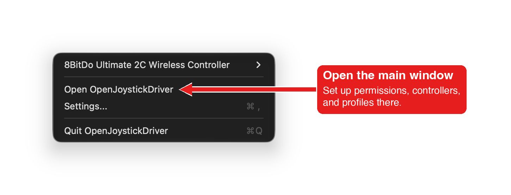
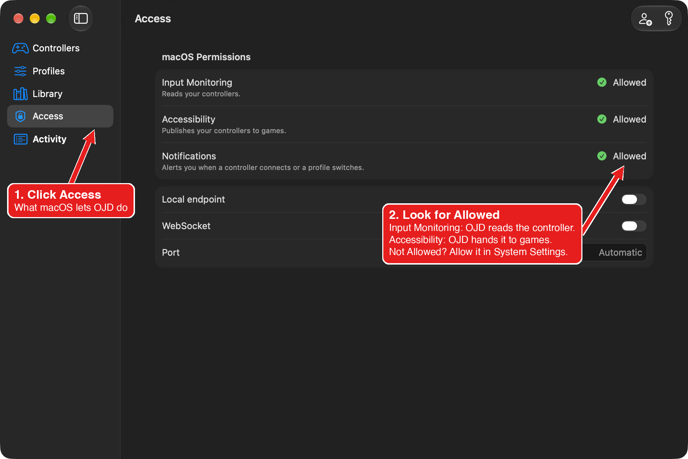
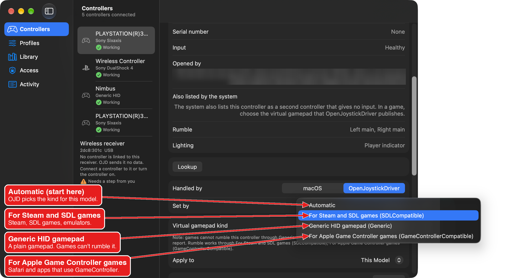

# Start: Play a Game with a Controller

Install OpenJoystickDriver (OJD), connect a controller, and play.

- **Who:** anyone with a controller that macOS doesn't support out of the box.
- **What you get:** games see a [virtual gamepad](Glossary.md#terms), a pretend controller that OJD drives from your real one.
- **Why:** many Mac games only understand a few controller kinds. The virtual gamepad is one of those kinds.
- **Where:** the OJD app, then your game.
- **When:** once per controller. On macOS 13 or later, OJD then starts when you log in.
- **How:** install OJD, allow two permissions, then connect the controller.
- **Time:** about five minutes.

## Set Up Your Controller

1. Open the disk image and drag **OpenJoystickDriver.app** onto **Applications**. Keep it in `/Applications`.
2. Open **OpenJoystickDriver** from the Applications folder.
3. Click the menu-bar icon and choose **Open OpenJoystickDriver**.

   
4. Click **Request...** next to each permission (or **Grant Access**), then allow OpenJoystickDriver when macOS asks. One permission lets OJD read the controller, and the other lets it hand the controller to games.

   
5. In the **Access** area, click **Restart OpenJoystickDriver** if it appears.
6. Connect the controller by USB cable, Bluetooth, or dongle.
7. Click **Controllers**, select the controller, and click **Open Input Test**. **Working** under its name means OJD reads it.

   
8. Press buttons and move the sticks. If nothing shows, see [Controller Is Not Detected](Troubleshooting.md#if-a-controller-isnt-detected).
9. Start the game. The game reads the virtual gamepad that OJD makes, as if it were your controller.

To check from Terminal, run `ojd status` and `ojd controller list`. See [Command Line](Command-Line.md#run-a-command).

## If the Game Shows No Input

Steam and SDL games work with the default [virtual gamepad kind](Glossary.md#terms). Apps that read controllers through Apple's own Game Controller support, such as Safari, need another kind. Pick it in the **Controllers** area:

Or use Terminal:

1. Run `ojd controller list` and copy your controller's ID.
2. Run `ojd virtual set game-controller-compatible CONTROLLER`.

To undo it, run `ojd virtual reset CONTROLLER`. Some games read neither kind. See [Game and App Compatibility](Playing-Games.md#game-and-app-compatibility).

## Further Reading

- [Playing Games](Playing-Games.md)
- [Supported Controllers](Supported-Controllers.md)
- [Permissions and Security](Permissions-and-Security.md#grant-input-monitoring-and-accessibility)
- [Game Does Not See the Controller](Troubleshooting.md#game-does-not-see-the-controller)
