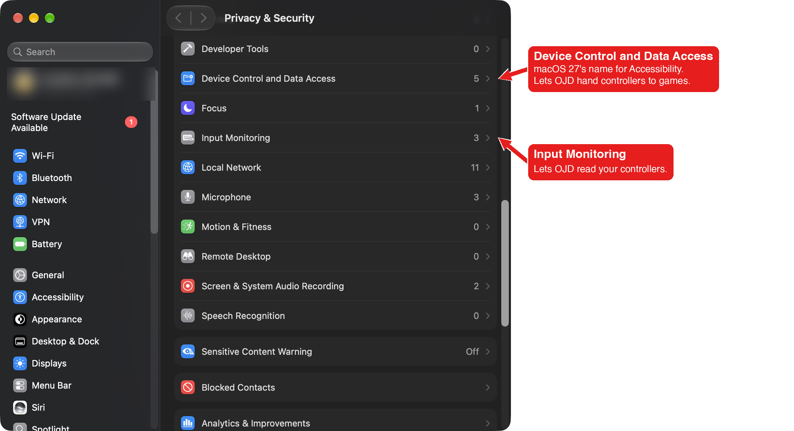
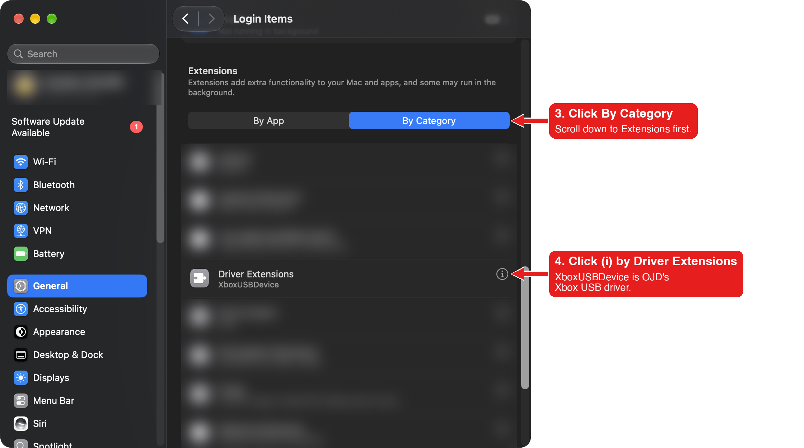

# Start: Set Up OJD on Several Macs

Install OJD on more than one Mac and copy your [profiles](Glossary.md#terms) and controller records between them.

Your profiles and records move as files: export them on the first Mac, copy the file over, and import it on the other. The macOS permissions don't move, because macOS keeps them per Mac, so each Mac asks again.

## Check the License

OJD is open source under the [Mozilla Public License 2.0](https://www.mozilla.org/MPL/2.0/). It sets no limit on how many Macs you install on and allows commercial use. If you give copies to others, their source stays available under the same license. Keep the license notices. The full text is in `LICENSE` at the repository root.

## Know What macOS Asks

Each Mac asks for its own approvals. Apple explains each one:

- [Allow a system extension](https://support.apple.com/en-us/120363), for the [Xbox USB driver](Glossary.md#terms).
- [Allow input monitoring](https://support.apple.com/guide/mac-help/control-access-to-input-monitoring-on-mac-mchl4cedafb6/mac).
- [Allow accessibility access](https://support.apple.com/guide/mac-help/allow-accessibility-apps-to-access-your-mac-mh43185/mac).

See [Permissions](Permissions-and-Security.md#permissions).

## Set Up Each Mac

1. Install OJD as in [Start: Play a Game with a Controller](Start-Play-a-Game.md).
2. Allow **Input Monitoring** and **Accessibility** (**Device Control and Data Access** on macOS 27). See [Grant Input Monitoring and Accessibility](Permissions-and-Security.md#grant-input-monitoring-and-accessibility).

   
3. In the **Access** area, click **Restart OpenJoystickDriver** if it appears.
4. For an Xbox controller on USB, approve the Xbox USB driver. See [Xbox USB Driver](Connecting-Controllers.md#xbox-usb-driver).

   
5. Run `ojd status` in Terminal.

## Copy Your Setup

On the first Mac, run `ojd profile export PROFILE --output FILE.plist`. On the other, run `ojd profile import FILE.plist`. The app has **File** > **Export Profile...** and **Import Profile...**. Copy a record or mod with `ojd record install FILE` or `ojd mod install FOLDER`. See [Importing and Exporting Profiles](Remapping-Profiles.md#importing-and-exporting-profiles).

## Further Reading

- [Updating and Uninstalling](Updating-and-Uninstalling.md)
- [Command Line](Command-Line.md)
- [Security Model](Permissions-and-Security.md#security-model)
