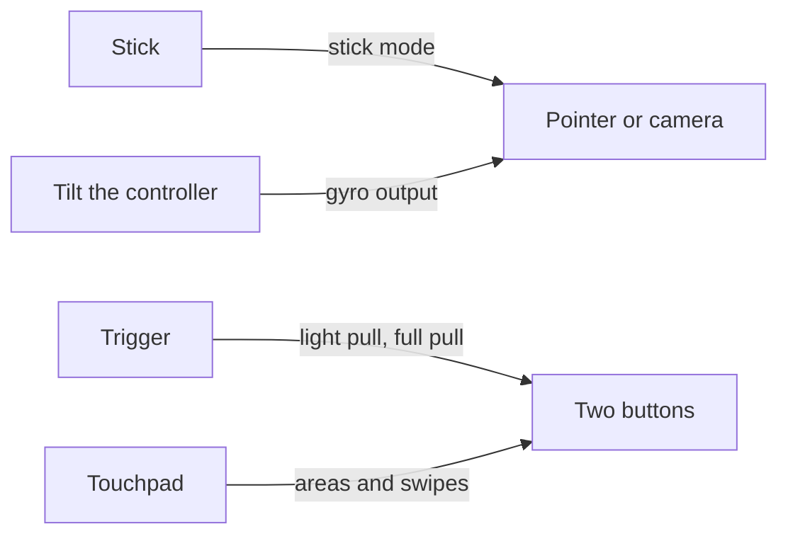
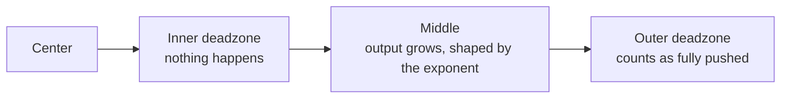
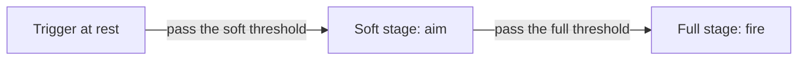
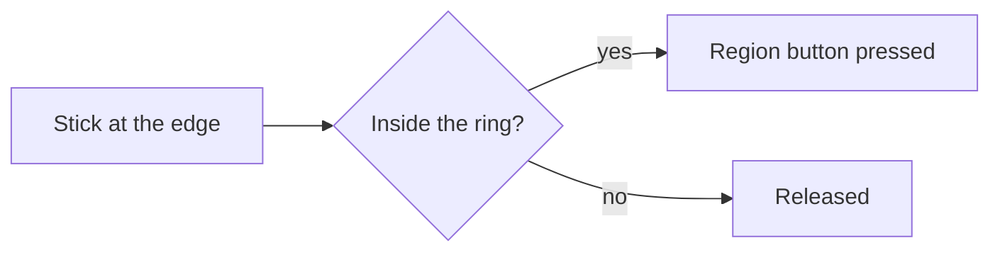

# Sticks, Triggers, Touchpad, and Motion

These settings change what a stick, trigger, touchpad, or tilt does.

## Contents

- [Before You Begin](#before-you-begin)
- [Set a Stick Mode](#set-a-stick-mode)
- [Set Trigger Stages](#set-trigger-stages)
- [Set Touch Mapping](#set-touch-mapping)
- [Set Regions](#set-regions)
- [Set Pointer Speed](#set-pointer-speed)
- [Set Motion Tuning and Gyro Output](#set-motion-tuning-and-gyro-output)
- [Create a Gyro to Stick Profile](#create-a-gyro-to-stick-profile)
- [Pair Two Joy-Con Controllers](#pair-two-joy-con-controllers)
- [Set the Lighting Color](#set-the-lighting-color)
- [Further Reading](#further-reading)

## Before You Begin

- [Create a profile](Remapping-Profiles.md#creating-a-profile).
- Choose **View** > **All Controls** (or set **Interface** in **Settings** > **General**).
- Open the profile's **Controller** section. Each group's pencil opens its sheet. **This controller can't do this.** means no such input.
- Pointer and scroll modes need Accessibility access ([Permissions](Permissions-and-Security.md)).
- Click **Save** on each sheet.
- These settings are untested on real hardware.

## Set a Stick Mode

1. Click the pencil (**Adjust Stick Modes**), select a stick.
2. Turn on **Enable pointer output**.
3. Select a **Stick mode** and change its settings.

| Stick mode | Result |
| --- | --- |
| **Aim** | Push turns the pointer at a steady speed. Default. |
| **Flick and Rotate** | A flick turns the pointer by the stick angle. Rotating turns it further. |
| **Flick Only**, **Rotate Only** | Only flicks, or only rotation, count. |
| **Pointer Area** | Pointer moves to an offset that follows the stick. |
| **Pointer Ring** | Pointer follows the stick on a ring. |
| **Scroll Wheel** | Rotating scrolls. |
| **Steering Wheel** | Rotating drives a virtual steering axis. |

Every mode has these (one push):

- **Inner deadzone** and **Outer deadzone**: see the diagram.
- **Response exponent**: higher is finer near center.
- **Axis inversion**: flips an axis.
- **Keep physical stick passthrough**: the game also gets the stick.
- **Positive rotation**: which turn counts as forward.

Ranges: [Profile file reference](Profile-File-Reference.md#analog-touch-and-motion-fields).

## Set Trigger Stages

A dual-stage trigger is two buttons in one.

1. Click the pencil (**Adjust Trigger Stages**) and select a trigger.
2. Turn on **Enable dual-stage trigger**.
3. Select a **Stage interaction** (such as **Soft and Full Together** or **Full Replaces Soft**) and set thresholds. Soft must be below full.
4. Save, then assign both stages in **Assignments**.

**Keep analog trigger passthrough** keeps the analog trigger in passthrough.

## Set Touch Mapping

1. Click the pencil (**Adjust Touch Mappings**) and select a **Surface**.
2. Turn on **Enable continuous touch output**.
3. Select a **Touch mode**: **Pointer**, **Left Stick**, or **Right Stick**.
4. Set the sensitivity, radius, or deadzone.

Touch contact, grid, and swipe also work as [assignment sources](Bindings-and-Actions.md#assigning-buttons-and-actions).

## Set Regions

A region is a pretend button on part of a stick, trigger, or touchpad. Assign it like any button.

1. Click the pencil (**Adjust Regions**).
2. Select a **Region type**: **Stick Ring**, **Trigger Band**, or **Touch Area**.
3. Select the **Input**, set the numbers, and select a **Destination**.
4. Click **Add Assignment**.

**Live position** shows the current position.

- **Stick Ring**: inner and outer radius, 0 to 1 after the dead zone. Optional sector in degrees clockwise from up (empty: whole ring).
- **Trigger Band**: start and end pull, 0 to 1. Can't combine with dual-stage mappings.
- **Touch Area**: left, top, width, height as surface fractions.

Rings and sectors of one stick can't overlap, nor can bands of one trigger. OJD rejects them on save. Command line: [Region sources](Bindings-and-Actions.md#region-sources).

## Set Pointer Speed

Like a gas pedal: press a trigger or stick further, and the pointer moves faster (or slower). Scrolling stays the same.

1. Click the pencil (**Adjust Pointer Speed**) and turn on **Scale pointer speed**.
2. Select the **Driver**, **Trigger** or **Stick Depth**, and the **Side**.
3. Set **Scale at 0**, **Scale at 1**, and a **Response curve**.

**Scale at 0**: at rest. **Scale at 1**: full pull or stick rim. Both 0 to 10; 0 stops the pointer. With several controllers, all scales apply.

Command line: [Pointer speed fields](Profile-File-Reference.md#pointer-speed-fields).

## Set Motion Tuning and Gyro Output

Motion tuning sets how strongly turns count.

1. Click the pencil (**Adjust Motion Tuning**).
2. Select the **Coordinate space** and set sensitivity and the rest.

In a layer, **Use Profile Tuning** restores the profile values.

**Gyro output** sends motion to **Mouse Pointer**, **Left Stick**, or **Right Stick** (default **Disabled**). Activation: **Always Active**, **While Held**, **While Released**, or **Toggle on Press**; all but the first need an **Activation control**.

A gyro trackball keeps the pointer gliding like a rolling ball. Ranges: [Profile file reference](Profile-File-Reference.md#analog-touch-and-motion-fields).

## Create a Gyro to Stick Profile

**Gyro to Stick** turns motion into a [virtual gamepad](Glossary.md#terms) stick, so stick-only games get gyro aiming.

1. Click **New Profile** and choose the controller.
2. Set **Template** to **Gyro to Stick**, then choose **Left Stick** or **Right Stick**.
3. Click **Create**.

Unmapped controls pass through. Gyro is always on; to limit it to while a control is held, set the activation in the motion sheet. No motion sensor, no profile. Command line: [Command reference](Command-Reference.md). The [hardware check](../docs/testing/gyro-stick.md) hasn't been run.

## Pair Two Joy-Con Controllers

A paired profile joins two Joy-Con. It must target the left Joy-Con model, `057E:2006`.

1. Create a profile. In **Profile Details**, select **Paired Joy-Con profile**.
2. Select the **Pair gyro source**: **Disabled**, **Left Joy-Con**, or **Right Joy-Con**.
3. Connect both and click **Pair Connected Joy-Cons...**.
4. **Pair active** means it works. Click **Unpair** to end it.

A paired Joy-Con profile has no **Set Active** button. Command line: `ojd controller pair LEFT RIGHT --profile PROFILE` or `ojd controller unpair PAIR`. Pairing is untested on real hardware.

## Set the Lighting Color

Pick a color in the **Lighting** editor of the **Controller** section. **Use controller default** clears it. Only controllers with lighting support it. See [Rumble and lighting](Playing-Games.md#rumble-and-lighting).

## Further Reading

- [Testing a controller](Testing-a-Controller.md)
