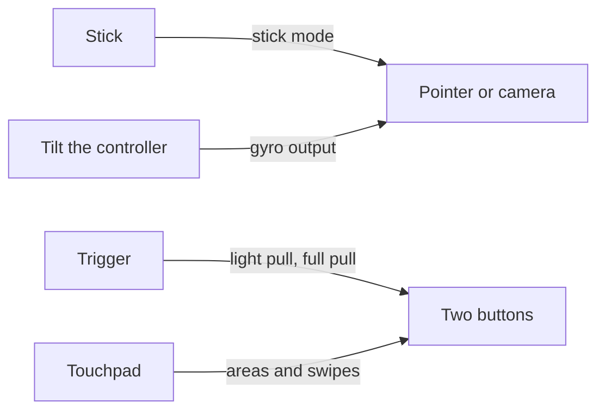
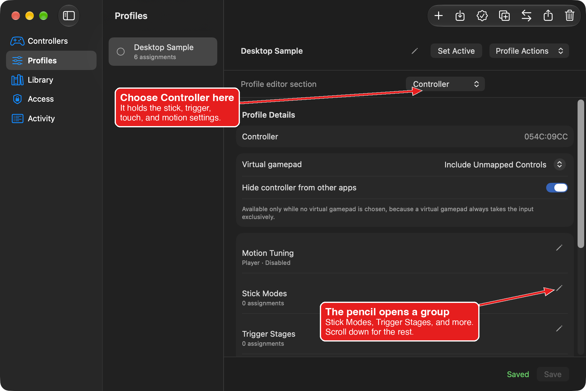
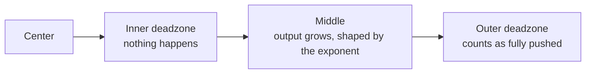
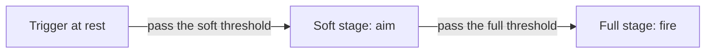
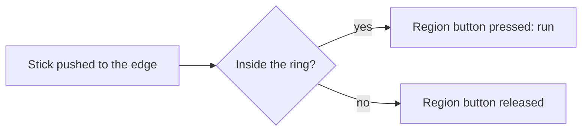

# Sticks, Triggers, Touchpad, and Motion

These settings change what happens when you move a stick, squeeze a trigger, touch a touchpad, or tilt a controller that senses motion.

- **Who:** anyone who wants more from sticks, triggers, touchpads, or motion.
- **What:** stick modes, trigger stages, touch areas, pointer speed, and gyro aiming.
- **Where:** sheets in the profile editor, in the **Profiles** area.
- **Why:** a stick can move the pointer, and tilting the controller can aim.
- **How:** open a profile, pick the sheet, change the setting, then save.

## Contents

- [Before You Begin](#before-you-begin)
- [Set a Stick Mode](#set-a-stick-mode)
- [Set Trigger Stages](#set-trigger-stages)
- [Set Touch Mapping](#set-touch-mapping)
- [Set Regions](#set-regions)
- [Set Pointer Speed](#set-pointer-speed)
- [Set Motion Tuning and Gyro Output](#set-motion-tuning-and-gyro-output)
- [Create a Gyro to Stick Profile](#create-a-gyro-to-stick-profile)
- [Pair Two Joy-Con Controllers](#pair-two-joy-con-controllers)
- [Set the Lighting Color](#set-the-lighting-color)
- [Further Reading](#further-reading)

## Before You Begin

- Create a [profile](Glossary.md#terms). See [Creating a profile](Remapping-Profiles.md#creating-a-profile).
- Set **Interface** to **All Controls** in **Settings** > **General**, or choose **View** > **All Controls**.
- Open the **Controller** section of the profile. Each group has a pencil button that opens its settings. A group that shows **This controller can't do this.** has no input to adjust.
- Pointer and scroll modes need Accessibility access. See [Permissions](Permissions-and-Security.md).

A profile has one mapping per stick, trigger, and touch surface. These settings are untested on real hardware.

## Set a Stick Mode

1. Click the pencil button (**Adjust Stick Modes**) in the **Stick Modes** group and select a stick.
2. Turn on **Enable pointer output**.
3. Select a **Stick mode** and change its settings.
4. Click **Save**.

| Stick mode | Result |
| --- | --- |
| **Aim** | Stick deflection turns the pointer at a steady speed. This is the default. |
| **Flick and Rotate** | A flick turns the pointer by the stick angle. Rotating then turns it further. |
| **Flick Only** | Flicks work and rotation is ignored. |
| **Rotate Only** | Rotation works and flicks are ignored. |
| **Pointer Area** | The pointer moves to an offset that follows the stick. |
| **Pointer Ring** | The pointer follows the stick on a ring. |
| **Scroll Wheel** | Rotating the stick scrolls. |
| **Steering Wheel** | Rotating the stick drives a virtual steering axis. |

These settings apply to every mode:

The diagram follows one push of the stick from the center to the edge:

- **Inner deadzone**: a small middle area where the stick does nothing, so a stick that rests slightly off center doesn't drift.
- **Outer deadzone**: an edge area that already counts as fully pushed.
- **Response exponent**: how fast the output grows as you push further. Higher values give finer control near the center.
- **Axis inversion**: flips up and down, or left and right.
- **Keep physical stick passthrough**: the game still gets the stick as a stick, too.
- **Positive rotation**: which way of turning counts as forward. For the ranges and defaults, see [Profile file reference](Profile-File-Reference.md#analog-touch-and-motion-fields).

## Set Trigger Stages

A dual-stage trigger acts like two buttons in one: a light squeeze (soft stage) and a full squeeze (full stage). Each stage can do its own job. For example, a light squeeze aims and a full squeeze fires.

1. Click the pencil button (**Adjust Trigger Stages**) in the **Trigger Stages** group and select a trigger.
2. Turn on **Enable dual-stage trigger**.
3. Select a **Stage interaction** and set the thresholds. The soft threshold must be below the full threshold.
4. Click **Save**.
5. In the **Assignments** section, assign the soft and full stages.

The **Stage interaction** menu decides how the two stages combine, for example **Soft and Full Together** or **Full Replaces Soft**. **Keep analog trigger passthrough** keeps the analog trigger in the passthrough output.

## Set Touch Mapping

1. Click the pencil button (**Adjust Touch Mappings**) in the **Touch Mappings** group and select a **Surface**.
2. Turn on **Enable continuous touch output**.
3. Select a **Touch mode**: **Pointer**, **Left Stick**, or **Right Stick**.
4. Set the sensitivity, radius, or deadzone.
5. Click **Save**.

Touch contact, grid, and swipe can also be assignment sources. See [Assigning buttons and actions](Bindings-and-Actions.md#assigning-buttons-and-actions).

## Set Regions

A region turns part of a stick, trigger, or touchpad into a pretend button, pressed while the input is inside that part. For example, a ring near the stick's edge can press "run" when you push the stick all the way. Assign a region like any other button.

1. Click the pencil button (**Adjust Regions**) in the **Regions** group.
2. Select a **Region type**: **Stick Ring**, **Trigger Band**, or **Touch Area**.
3. Select the **Input**, set the numbers, and select a **Destination**.
4. Click **Add Assignment**, then **Save**.

While a controller is connected, **Live position** shows the region and the current position.

- **Stick Ring** takes an inner and outer radius, from 0 to 1 after the dead zone. An optional sector is in degrees clockwise from up. Leave the sector empty for the whole ring.
- **Trigger Band** takes a start and end pull, from 0 to 1. A trigger with bands cannot also have dual-stage mappings.
- **Touch Area** takes the left edge, top edge, width, and height as fractions of the surface.

Rings and sectors of one stick cannot overlap, and neither can bands of one trigger. OJD rejects the profile when you save it. For the command line, see [Region sources](Bindings-and-Actions.md#region-sources).

## Set Pointer Speed

Pointer speed lets a trigger or stick work like a gas pedal for the mouse pointer: the further you press, the faster (or slower) it moves. Scrolling doesn't change.

1. Click the pencil button (**Adjust Pointer Speed**) in the **Pointer Speed** group and turn on **Scale pointer speed**.
2. Select the **Driver**, **Trigger** or **Stick Depth**, and the **Side**.
3. Set **Scale at 0** and **Scale at 1**, and select a **Response curve**.
4. Click **Save**.

**Scale at 0** applies when the driver is at rest. **Scale at 1** applies when the trigger is fully pulled or the stick is at its rim. Both range from 0 to 10, and 0 stops the pointer. With several controllers, all their scales apply to the one pointer.

For the command line, see [Pointer speed fields](Profile-File-Reference.md#pointer-speed-fields).

## Set Motion Tuning and Gyro Output

A gyro is the motion sensor inside some controllers. It notices when you turn or tilt the controller, and motion tuning sets how strongly those turns count.

1. Click the pencil button (**Adjust Motion Tuning**) in the **Motion Tuning** group.
2. Select the **Coordinate space** and set the sensitivity and other values.
3. Click **Save**. In a layer, **Use Profile Tuning** restores the profile values.

**Gyro output** sends motion to **Mouse Pointer**, **Left Stick**, or **Right Stick**. It is **Disabled** by default. The activation is **Always Active**, **While Held**, **While Released**, or **Toggle on Press**. Any activation but **Always Active** needs an **Activation control**.

A gyro trackball keeps the pointer gliding after you hold a control, like a ball you flicked that keeps rolling. Motion needs a controller with motion sensors. For the ranges, see [Profile file reference](Profile-File-Reference.md#analog-touch-and-motion-fields).

## Create a Gyro to Stick Profile

The **Gyro to Stick** template makes turning the controller move a stick of the [virtual gamepad](Glossary.md#terms), so a game that reads only sticks gets gyro aiming.

1. Click **New Profile** and choose the controller.
2. Set **Template** to **Gyro to Stick**, then choose **Left Stick** or **Right Stick**.
3. Click **Create**.

The profile passes every unmapped control through the virtual gamepad, and gyro output is always on. To limit it to while a control is held, set the activation in the motion sheet. If the controller has no motion sensor, OpenJoystickDriver creates no profile. For the command line, see [Command reference](Command-Reference.md). The [hardware check](../docs/testing/gyro-stick.md) has not been run on a controller.

## Pair Two Joy-Con Controllers

A paired Joy-Con profile combines a left and a right Joy-Con. It must target the Nintendo left Joy-Con model, `057E:2006`.

1. Create a profile. In **Profile Details**, select **Paired Joy-Con profile**.
2. Select the **Pair gyro source**: **Disabled**, **Left Joy-Con**, or **Right Joy-Con**.
3. Connect both Joy-Con controllers.
4. Click **Pair Connected Joy-Cons...**.
5. When **Pair active** appears, the pair works. Click **Unpair** to end it.

A paired Joy-Con profile has no **Set Active** button. On the command line, run `ojd controller pair LEFT RIGHT --profile PROFILE` or `ojd controller unpair PAIR`. Pairing is untested on real hardware.

## Set the Lighting Color

In the **Controller** section, the **Lighting** editor sets a color. Select **Use controller default** to clear it. Only controllers with lighting support this. See [Rumble and lighting](Playing-Games.md).

## Further Reading

- [Bindings and actions](Bindings-and-Actions.md)
- [Testing a controller](Testing-a-Controller.md)
