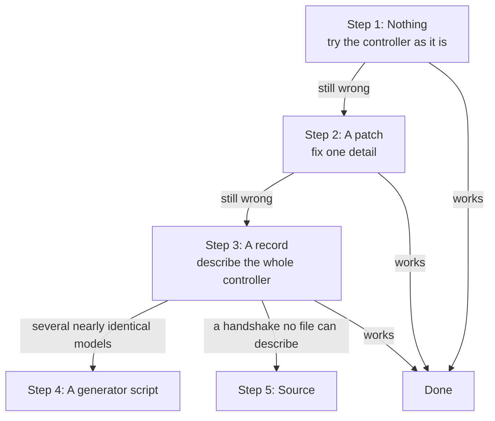

# Support Ladder

Is your controller acting up in OpenJoystickDriver (OJD)? Climb this ladder one step at a time. Each step takes more work than the one before, so stop at the first one that works.

Do this before you write a record or report a bug. There are five steps, from doing nothing to changing the source.



## Contents

- [Step 1: Nothing](#step-1-nothing)
- [Step 2: A Patch](#step-2-a-patch)
- [Step 3: A Record](#step-3-a-record)
- [Step 4: A Generator Script](#step-4-a-generator-script)
- [Step 5: Source](#step-5-source)
- [Further Reading](#further-reading)

Steps 1 to 3 need no build and no pull request.

A record is a small file that tells OJD how a controller works, such as which bytes mean which button and how strong the rumble is. A patch is a smaller file that fixes one detail of a record OJD already has. Both are XML property lists (`.plist`), the kind of file macOS uses for settings. `plutil -lint FILE.plist` checks one, and `plutil -convert json -o - FILE.plist` reads one as JSON. Each file declares `apiVersion` `openjoystickdriver/v1alpha3`.

## Step 1: Nothing

Many controllers work with no file at all. Most describe themselves when you plug them in, like a name badge that lists their buttons (the HID report descriptor). Xbox controllers use the Xbox way of talking instead (Xbox USB and GIP). OJD reads both.

1. Run `ojd controller list` to find the vendor and product numbers (VID:PID, such as `045E:02EA`).
2. Run `ojd controller show VVVV:PPPP`. It shows the identity, handler, capabilities, and [virtual gamepad](Glossary.md#terms). For a device OJD doesn't handle, it shows the reason and next step.
3. In **Controllers**, click **Open Input Test** and press every control.


Stop here if every control reads correctly. If the controller is [Handled by macOS](Glossary.md#terms) and you want OJD to handle it, run `ojd controller claim VVVV:PPPP`.

## Step 2: A Patch

Use a patch when OJD knows your controller but one detail is wrong, such as a stick deadzone (how far you push the stick before it counts). A `ControllerPatch` changes only the parts that differ from the record built into OJD, like a sticky note on a page. `selector` names the model, `patch` holds the changes, and `remove` lists key paths to delete. See [Controller Records](Controller-Records.md#how-records-work).

1. Run `ojd record draft VVVV:PPPP > 045e-02ea.patch.plist` and press every control for 10 seconds. For a model with a bundled record, the draft is a patch.
2. Correct the file. This complete patch sets the stick deadzone of `045E:02EA`:

   ```xml
   <?xml version="1.0" encoding="UTF-8"?>
   <!DOCTYPE plist PUBLIC "-//Apple//DTD PLIST 1.0//EN" "http://www.apple.com/DTDs/PropertyList-1.0.dtd">
   <plist version="1.0">
   <dict>
    <key>apiVersion</key>
    <string>openjoystickdriver/v1alpha3</string>
    <key>kind</key>
    <string>ControllerPatch</string>
    <key>patch</key>
    <dict>
     <key>tuning</key>
     <dict>
      <key>stickDeadzone</key>
      <real>0.08</real>
     </dict>
    </dict>
    <key>selector</key>
    <dict>
     <key>productID</key>
     <integer>746</integer>
     <key>vendorID</key>
     <integer>1118</integer>
    </dict>
   </dict>
   </plist>
   ```

3. Run `ojd record validate 045e-02ea.patch.plist`. It exits with code 1 for an invalid patch or one that changes nothing.
4. Run `ojd record install 045e-02ea.patch.plist`. The running service applies it.
5. Run `ojd record show 045E:02EA` to see the applied record and the layer of each field.

To undo it, run `ojd record remove 045E:02EA`.

## Step 3: A Record

Use a record when OJD doesn't know your controller. A `Controller` file describes the whole model: its modes, its buttons and sticks, its rumble, and its tuning. For a model with a bundled record, write a patch instead.

1. Run `ojd record draft VVVV:PPPP > 1209-0001.plist` for a connected controller. To start from its SDL_GameControllerDB line, run `ojd record draft VVVV:PPPP --from-sdl > 1209-0001.plist` instead.
2. Correct the file. This record is the sample in [`docs/sdk/sample`](../docs/sdk/sample), with pid.codes test ID `1209:0001`:

   ```xml
   <?xml version="1.0" encoding="UTF-8"?>
   <!DOCTYPE plist PUBLIC "-//Apple//DTD PLIST 1.0//EN" "http://www.apple.com/DTDs/PropertyList-1.0.dtd">
   <plist version="1.0">
   <dict>
    <key>apiVersion</key>
    <string>openjoystickdriver/v1alpha3</string>
    <key>input</key>
    <dict>
     <key>layouts</key>
     <array>
      <dict>
       <key>axes</key>
       <array>
        <dict>
         <key>bitOffset</key>
         <integer>16</integer>
         <key>bitSize</key>
         <integer>8</integer>
         <key>control</key>
         <string>LeftStickX</string>
        </dict>
        <dict>
         <key>bitOffset</key>
         <integer>24</integer>
         <key>bitSize</key>
         <integer>8</integer>
         <key>control</key>
         <string>LeftStickY</string>
        </dict>
        <dict>
         <key>bitOffset</key>
         <integer>32</integer>
         <key>bitSize</key>
         <integer>8</integer>
         <key>control</key>
         <string>RightStickX</string>
        </dict>
        <dict>
         <key>bitOffset</key>
         <integer>40</integer>
         <key>bitSize</key>
         <integer>8</integer>
         <key>control</key>
         <string>RightStickY</string>
        </dict>
       </array>
       <key>buttons</key>
       <array>
        <dict>
         <key>bitOffset</key>
         <integer>0</integer>
         <key>bitSize</key>
         <integer>1</integer>
         <key>control</key>
         <string>South</string>
        </dict>
        <dict>
         <key>bitOffset</key>
         <integer>1</integer>
         <key>bitSize</key>
         <integer>1</integer>
         <key>control</key>
         <string>East</string>
        </dict>
        <dict>
         <key>bitOffset</key>
         <integer>2</integer>
         <key>bitSize</key>
         <integer>1</integer>
         <key>control</key>
         <string>West</string>
        </dict>
        <dict>
         <key>bitOffset</key>
         <integer>3</integer>
         <key>bitSize</key>
         <integer>1</integer>
         <key>control</key>
         <string>North</string>
        </dict>
        <dict>
         <key>bitOffset</key>
         <integer>4</integer>
         <key>bitSize</key>
         <integer>1</integer>
         <key>control</key>
         <string>LeftShoulder</string>
        </dict>
        <dict>
         <key>bitOffset</key>
         <integer>5</integer>
         <key>bitSize</key>
         <integer>1</integer>
         <key>control</key>
         <string>RightShoulder</string>
        </dict>
        <dict>
         <key>bitOffset</key>
         <integer>6</integer>
         <key>bitSize</key>
         <integer>1</integer>
         <key>control</key>
         <string>Back</string>
        </dict>
        <dict>
         <key>bitOffset</key>
         <integer>7</integer>
         <key>bitSize</key>
         <integer>1</integer>
         <key>control</key>
         <string>Start</string>
        </dict>
       </array>
       <key>hat</key>
       <array>
        <dict>
         <key>bitOffset</key>
         <integer>8</integer>
         <key>bitSize</key>
         <integer>4</integer>
         <key>encoding</key>
         <string>EightWay</string>
        </dict>
       </array>
       <key>leftTrigger</key>
       <dict>
        <key>bitOffset</key>
        <integer>48</integer>
        <key>bitSize</key>
        <integer>8</integer>
       </dict>
       <key>report</key>
       <dict>
        <key>length</key>
        <dict>
         <key>atLeast</key>
         <integer>8</integer>
        </dict>
       </dict>
       <key>rightTrigger</key>
       <dict>
        <key>bitOffset</key>
        <integer>56</integer>
        <key>bitSize</key>
        <integer>8</integer>
       </dict>
      </dict>
     </array>
    </dict>
    <key>kind</key>
    <string>Controller</string>
    <key>modes</key>
    <array>
     <dict>
      <key>id</key>
      <string>default</string>
      <key>protocol</key>
      <dict>
       <key>family</key>
       <string>HIDReportLayout</string>
      </dict>
     </dict>
    </array>
    <key>productID</key>
    <integer>1</integer>
    <key>vendorID</key>
    <integer>4617</integer>
   </dict>
   </plist>
   ```

3. Run `ojd record validate 1209-0001.plist`.
4. Run `ojd record install 1209-0001.plist`. Add `--dry-run` to see the target path without writing.
5. Test the record against a recording of the controller (a capture). Run `ojd --json controller capture VVVV:PPPP > capture.jsonl` while you press buttons. Then run `ojd record test VVVV:PPPP --packets capture.jsonl --expect state.json`. It plays the recording through your record and lists each control that came out different from `state.json`.

To share a record, put it in a [mod package](Writing-Controller-Mods.md).

## Step 4: A Generator Script

Use a generator script when several models are nearly the same, such as one maker's whole product line. Instead of copying a record many times, write one small JavaScript file that prints them all.

1. Write the script. [Generating Documents with Scripts](Generating-Documents-with-Scripts.md) shows one for three records.
2. Print the documents with `ojd generate family.js`, or write them into a folder with `ojd generate family.js --output Controllers`.
3. Validate and install each file as in step 3: `ojd record validate Controllers/VVVV-PPPP.plist`, then `ojd record install Controllers/VVVV-PPPP.plist`.

## Step 5: Source

Change OJD's Swift code only when the controller talks in a way OJD can't speak, such as a secret handshake or encryption. First check that a patch or record can't describe it. A fact about one model, such as which byte is the A button, belongs in a record, not in the code. See [CONTRIBUTING.md](../CONTRIBUTING.md) and [Reporting a Bug](Reporting-a-Bug.md).

## Further Reading

- [Start: Add Support for a Controller](Start-Add-Support-for-a-Controller.md)
- [Controller Records](Controller-Records.md)
- [Writing Controller Mods](Writing-Controller-Mods.md)
- [Command Reference](Command-Reference.md)
