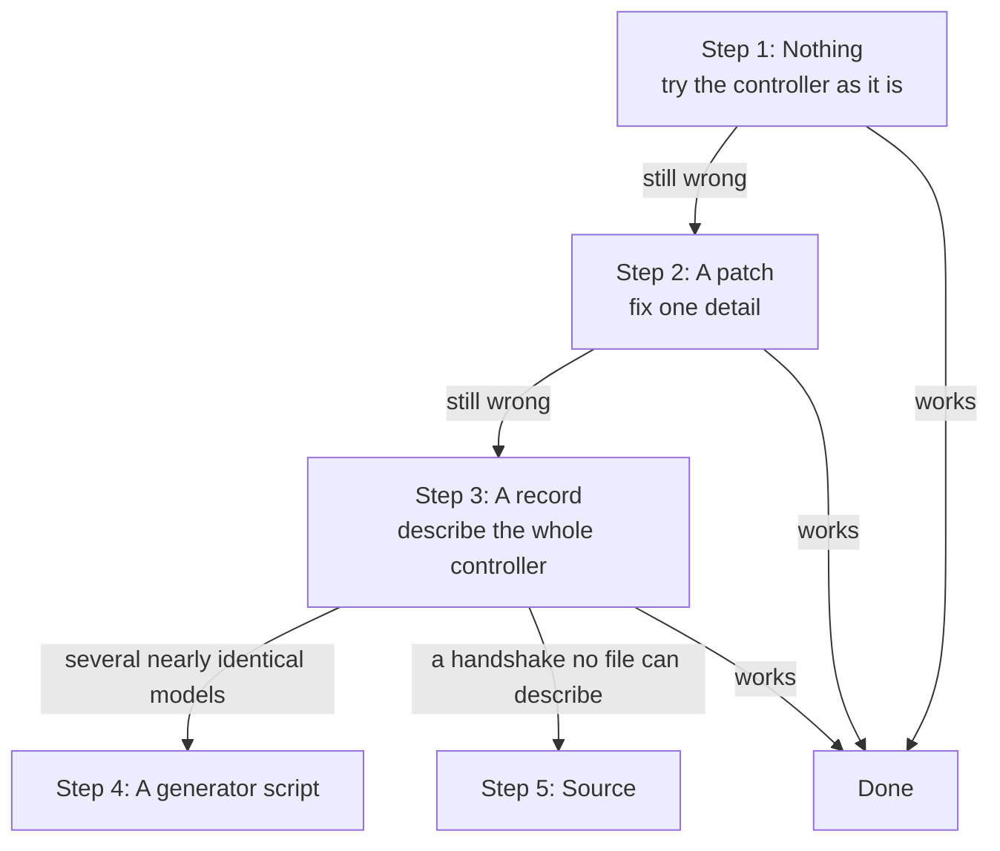
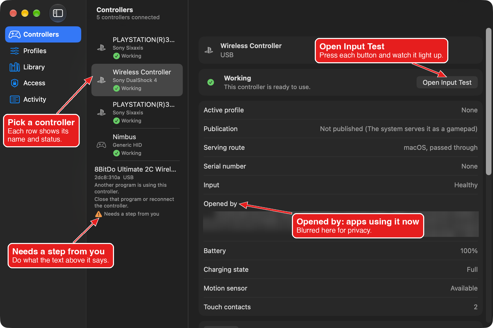

# Support Ladder

Controller acting up? Climb one step at a time and stop at the first one that works. Try this before you write a record or report a bug.



Steps 1 to 3 need no build and no pull request.

A record is a small file that says how a controller works: which bytes are which button, how strong the rumble is. A patch fixes one detail of a record OJD already has. Both are `.plist` files with `apiVersion` `openjoystickdriver/v1alpha4`. `plutil -lint FILE.plist` checks one.

## Contents

- [Step 1: Nothing](#step-1-nothing)
- [Step 2: A Patch](#step-2-a-patch)
- [Step 3: A Record](#step-3-a-record)
- [Step 4: A Generator Script](#step-4-a-generator-script)
- [Step 5: Source](#step-5-source)
- [Further Reading](#further-reading)

## Step 1: Nothing

Many controllers work with no file. Most carry a name badge (the HID report descriptor) and Xbox controllers speak Xbox USB and GIP. OJD reads both.

1. Run `ojd controller list` to find the vendor and product numbers (VID:PID, such as `045E:02EA`).
2. Run `ojd controller show VVVV:PPPP`.
3. In **Controllers**, click **Open Input Test** and press every control.



Every control reads right? Stop. If the controller is [Handled by macOS](Glossary.md#terms) and you want OJD to handle it, run `ojd controller claim VVVV:PPPP`.

## Step 2: A Patch

Use a patch when OJD knows your controller but one detail is wrong, such as the stick deadzone (how far you push before it counts). A patch is a sticky note on the built-in record. `selector` names the model, `patch` holds the changes, and `remove` lists key paths to delete. See [Controller Records](Controller-Records.md#how-records-work).

1. Run `ojd record draft VVVV:PPPP > 045e-02ea.patch.plist` and press every control for 10 seconds.
2. Fix the file. This complete patch sets the stick deadzone of `045E:02EA`:

   ```xml
   <?xml version="1.0" encoding="UTF-8"?>
   <!DOCTYPE plist PUBLIC "-//Apple//DTD PLIST 1.0//EN" "http://www.apple.com/DTDs/PropertyList-1.0.dtd">
   <plist version="1.0">
   <dict>
    <key>apiVersion</key>
    <string>openjoystickdriver/v1alpha4</string>
    <key>kind</key>
    <string>ControllerPatch</string>
    <key>patch</key>
    <dict>
     <key>tuning</key>
     <dict>
      <key>stickDeadzone</key>
      <real>0.08</real>
     </dict>
    </dict>
    <key>selector</key>
    <dict>
     <key>productID</key>
     <integer>746</integer>
     <key>vendorID</key>
     <integer>1118</integer>
    </dict>
   </dict>
   </plist>
   ```

3. Run `ojd record validate 045e-02ea.patch.plist`. It exits with code 1 for an invalid patch or one that changes nothing.
4. Run `ojd record install 045e-02ea.patch.plist`. The running service applies it.
5. Run `ojd record show 045E:02EA` to see the applied record and each field's layer.

Undo it with `ojd record remove 045E:02EA`.

## Step 3: A Record

Use a record when OJD doesn't know your controller. A `Controller` file describes the whole model. For a model with a bundled record, write a patch.

1. Run `ojd record draft VVVV:PPPP > 1209-0001.plist`. To start from its SDL_GameControllerDB line, add `--from-sdl`.
2. Fix the file. A complete working record, with pid.codes test ID `1209:0001`, is [`docs/sdk/sample/Controllers/1209-0001.plist`](../docs/sdk/sample/Controllers/1209-0001.plist).

3. Run `ojd record validate 1209-0001.plist`.
4. Run `ojd record install 1209-0001.plist`. Add `--dry-run` to see the target path without writing.
5. Test it against a recording (a capture). Press buttons while you run `ojd --json controller capture VVVV:PPPP > capture.jsonl`. Then run `ojd record test VVVV:PPPP --packets capture.jsonl --expect state.json`. It lists each control that differs from `state.json`.

To share a record, use a [mod package](Writing-Controller-Mods.md).

## Step 4: A Generator Script

Use a script when several models are nearly the same. One small JavaScript file prints all the records.

1. Write the script. [Generating Documents with Scripts](Generating-Documents-with-Scripts.md) shows one for three records.
2. Run `ojd generate family.js`, or add `--output Controllers` to write a folder.
3. Validate and install each file as in step 3.

## Step 5: Source

Change the Swift code only when the controller talks in a way OJD can't speak, such as a secret handshake or encryption. A fact about one model, such as which byte is the A button, belongs in a record. See [CONTRIBUTING.md](../CONTRIBUTING.md) and [Reporting a Bug](Reporting-a-Bug.md).

## Further Reading

- [Start: Add Support for a Controller](Start-Add-Support-for-a-Controller.md)
- [Controller Records](Controller-Records.md)
- [Writing Controller Mods](Writing-Controller-Mods.md)
- [Command Reference](Command-Reference.md)
