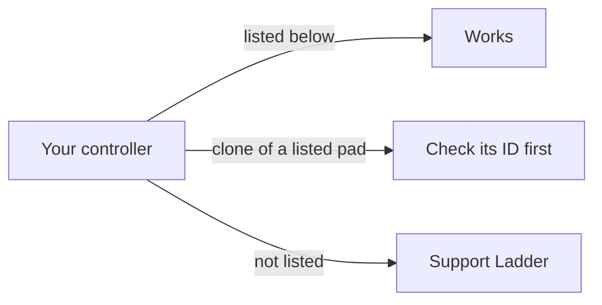
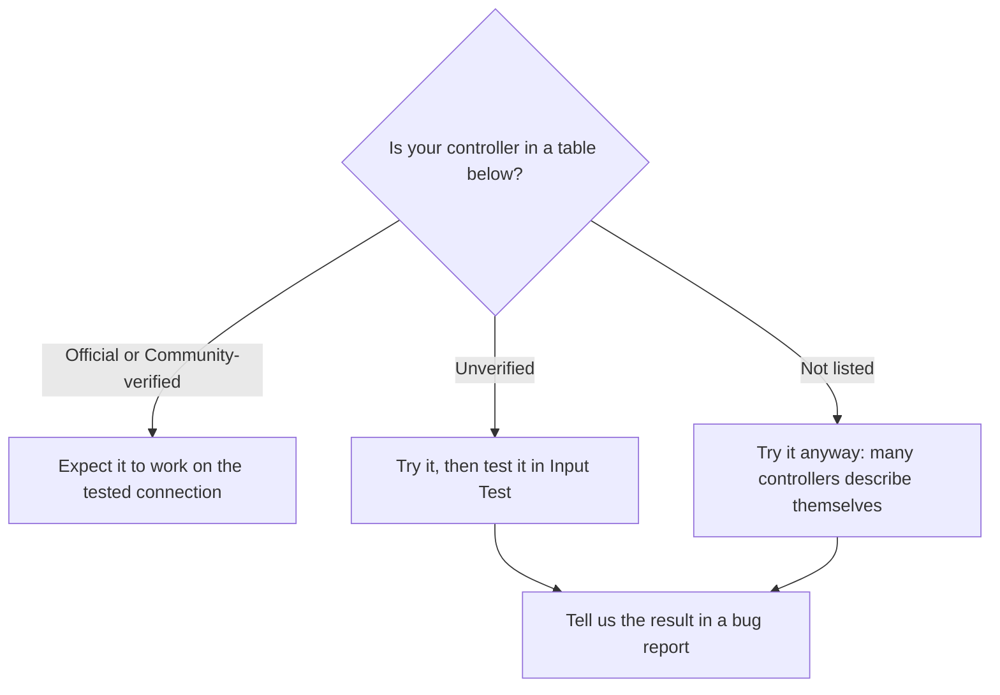
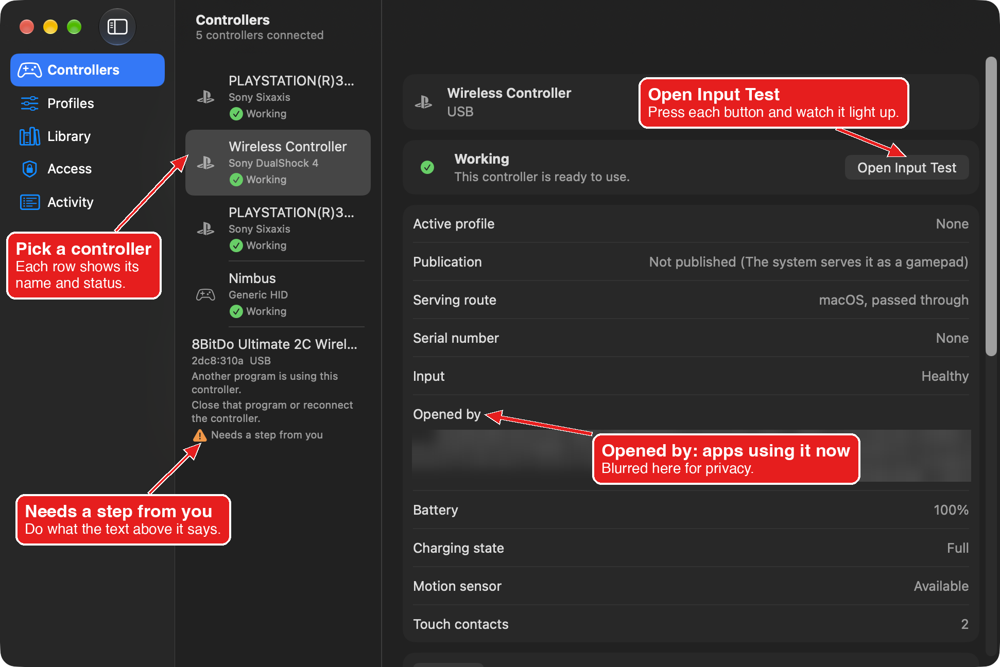

# Supported Controllers

Find out whether your controller works with OpenJoystickDriver (OJD), and what to expect from a clone or a controller that OJD doesn't list.

Xbox and PlayStation names are trademarks of Microsoft and Sony. This project isn't affiliated with either company.

- **Who:** anyone checking whether their controller works.
- **What:** the list of supported controllers, plus clones and plain HID pads.
- **When:** before you buy a controller, or when yours isn't detected.
- **How:** find your model below; if it's missing, see [Support Ladder](Support-Ladder.md).



## Contents

- [Supported Controllers](#supported-controllers-1)
- [Clone and Fake Controllers](#clone-and-fake-controllers)
- [Generic HID Controllers](#generic-hid-controllers)
- [Further Reading](#further-reading)

## Supported Controllers

Each controller sits in one of three tiers, like grades on a report card. The tier tells you how sure anyone is that it works, because someone tried it on a real controller. The app doesn't show the tier; only this page does.

- Official: the maintainer owns and tests it.
- Community-verified: a tester used it on real hardware and it worked.
- Unverified: nobody has confirmed it.



A test covers only the connection the tester used. Another connection may not work. See [Connection types](Connecting-Controllers.md#connection-types).

### Official

| Controller | Connection tested |
| --- | --- |
| Sony DUALSHOCK 4 (v2) | Not recorded |
| Sony DUALSHOCK 3 (CECHZC2) | USB |
| Sony DUALSHOCK 3 (CECHZC1) | USB |
| GameSir G7 SE | USB |
| Razer Wolverine (V1) Tournament Edition | USB |

> [!NOTE]
> The DUALSHOCK 3 doesn't connect over Bluetooth on macOS 27.0. macOS asks for a passcode that the controller can't answer. Use a USB cable.

### Community-Verified

A tester used each controller below on real hardware. The app marks a verified connection as Community verified in the controller's details.

The **Lookup** button in the details opens this page. For a controller with no record, it opens a GitHub issue search for the controller's ID.

| Controller | ID | Connection tested | What works | Not tested |
| --- | --- | --- | --- | --- |
| 8BitDo Ultimate 2C Wireless | `2DC8:310A` | 2.4 GHz dongle, XInput mode | Buttons, sticks, D-pad, rumble | Not recorded |
| ZD Ultimate Legend | `413D:2204` | 2.4 GHz dongle, XInput mode | Input, rumble, back buttons | Not recorded |
| Xbox Nano Controller | `045E:0B4F` | Bluetooth LE | Buttons, sticks, triggers, D-pad. No Xbox or Share button | Rumble, Steam |
| NITHO MLT-KRMA-K | `054C:05C4` | Bluetooth, M mode | Buttons, sticks, triggers, D-pad. M1 and M2 need a recorded macro | Rumble, light |
| NITHO MLT-KRMA-K | `054C:05C4` | USB, M mode | Buttons, sticks, triggers, D-pad. Home drops the pad | Rumble, light |
| NITHO MLT-KRMA-K | `045E:028E` | 2.4G receiver, or USB in X or 2.4G mode | Buttons, sticks, triggers, D-pad, Home, rumble | X mode over Bluetooth |
| NITHO MLT-KRMA-K | `2563:0526` | USB, V3 mode | Buttons, sticks, triggers, D-pad, Home | Rumble |
| NITHO MLT-KRMA-K | `057E:2009` | USB and Bluetooth, S mode | Buttons, sticks, D-pad. Triggers are on or off | Rumble, light |
| NITHO MLT-KRMA-K | `1949:0402` | Bluetooth LE, V3 mode | Buttons, left stick, D-pad. Right stick is slow. RB, View, Menu, Home send nothing | Not recorded |
| NITHO MLT-KRMA-K | `1949:0402` | Bluetooth LE, 2.4G mode | Buttons, sticks, triggers, D-pad. Home sends nothing | Not recorded |

Test records: [8BitDo Ultimate 2C](../docs/testing/8bitdo-ultimate-2c.md), [Xbox Nano](../docs/testing/xbox-nano.md), and [NITHO MLT-KRMA-K](../docs/testing/nitho-mlt-krma-k.md). The 8BitDo Ultimate 2C has a different ID in each mode, and the Ultimate 2 and Ultimate 3-mode records are unverified. Both are in the [Ultimate 2 test record](../docs/testing/8bitdo-ultimate-2.md). OJD never writes to a controller in bootloader mode.

### Unverified

OJD has a built-in list of controllers. Its catalog holds 714 controller records. A record is a recipe card that tells OJD how one controller speaks. A controller the tables above don't list is unverified. It may work, work in part, or not work. That doesn't mean it is broken or fake. The Wii Remote is unverified too. See [Wii Remote](Wii-Remote.md).

### Flydigi Records

These records come from published source code. See [Flydigi tester checks](../docs/testing/flydigi-tester-checks.md).

| Controller | ID | Connection | Test record |
| --- | --- | --- | --- |
| Flydigi Vader 4 Pro | `D7D7:0041` | Bluetooth LE | [Vader 4 Pro](../docs/testing/flydigi-vader-4-pro.md) |
| Flydigi Vader 5S | `37D7:2801` | USB | [Vader 5S](../docs/testing/flydigi-vader-5s.md) |
| Flydigi Vader 5 Pro dongle | `37D7:2401` | 2.4 GHz USB | [Vader 5 Pro](../docs/testing/flydigi-vader-5-pro.md) |
| Flydigi Apex 4 | `04B4:2412` | DInput | [Apex 4](../docs/testing/flydigi-apex-4.md) |

### SteelSeries Nimbus Record

The SteelSeries Nimbus (USB, `1038:1420`) has an unverified record from published source code. It maps the buttons, D-pad, sticks, and triggers. macOS handles the Nimbus as its own game controller ([Handled by macOS](Glossary.md#terms)), and OJD only reads its input. OJD doesn't drive its player lights.

### Check Whether Your Controller Is in the Catalog

1. Connect the controller.
2. Click **Controllers** in the sidebar.
3. Look for your controller in the list.

In Terminal, run:

```shell
ojd controller list
```

If your controller isn't listed, see [If a Controller Isn't Detected](Troubleshooting.md#if-a-controller-isnt-detected). A controller with no record may still work as a [generic controller](#generic-hid-controllers).

### Report a Result

Tell the maintainer which connection you used and what worked. See [Reporting a Bug](Reporting-a-Bug.md).

## Clone and Fake Controllers

Some controllers look like a Sony or Microsoft controller but have a different chip and ID inside. OJD tells controllers apart by ID, the way a mail carrier goes by the address, whatever the house looks like. See [Finding Your Controller ID](Connecting-Controllers.md#finding-your-controller-id).

Clones often send data in another format, so the original's driver may misread them. Don't report a clone under the original's name.

### Known Clones

| Controller | Copies | Notes |
| --- | --- | --- |
| Zhongqing ZQDZ-P3-BT-3D-FZ-V2.0 | PS3 controller | The maintainer owns it. Chip unknown. |
| Ant Esports GP100 | PS3 controller | A Shanwan clone. ID 2563:0575 in PS3/PC mode. |

The Ant Esports GP100 starts in XInput mode, where macOS sees no input. Hold **Select** and **B** while you connect it to switch to PS3/PC mode. One tester reports **Start** and **B** instead. See [the Shanwan test record](../docs/testing/ps3-third-party.md).

## Generic HID Controllers

OJD can read some gamepads that aren't in its catalog. HID (Human Interface Device) is the standard way a gamepad tells a computer what it has, like a menu that lists its buttons and sticks. That menu is called the report descriptor. OJD reads it and works out the rest.

If no record fits, but the controller passes the checks below, OJD still serves it as a generic controller. `ojd controller show` says so, and the **Controllers** area of the app lists it like any other controller.



A record that keeps the pad with macOS, or an idle mode, stays as it is. OJD doesn't retry a failing known controller as a generic one.

### What Works

- Buttons 1 to 11: south, east, west, north, LB, RB, view, menu, L3, R3, and guide.
- Two sticks and two triggers.
- One eight-position D-pad.

Generic gamepads have no rumble and no lighting. Paddles and other extra controls need a controller record.

### When OJD Refuses a Controller

OJD accepts a generic gamepad only when its descriptor passes these checks:

- It has a Joystick, Game Pad, or Multi-axis Controller collection.
- That collection has a stick or hat input and a button input.
- It has no unsupported or inconsistent items.

A controller that fails a check is listed as unbound with the reason and what to do. The **Controllers** area shows the same text. To see it, run:

```shell
ojd status
```

See [Using the Command Line](Command-Line.md). A controller with odd axes needs a record.

### Mapping Source

A mapping says which of the controller's buttons is "A", which is "B", and so on. A controller with no record gets its mapping from the Mac lines of [SDL_GameControllerDB](https://github.com/mdqinc/SDL_GameControllerDB). `ojd controller show` then reads "mapped from SDL_GameControllerDB" with the GUID and the match tier, best first:

1. `ExactGUID`: version and name hash match.
2. `GUIDWithoutNameCRC`: version matches, and the line has no name hash.
3. `GUIDWithoutVersion`: name hash matches, and the version doesn't.
4. `GUIDWithoutVersionAndNameCRC`: only vendor and product match.

When a GUID has several lines, the last one wins. An axis that stands for a button presses it past half its range. Controls OJD can't express are listed as unmapped, and the others still work.

With no matching line, the controller keeps the standard map and the row reads "standard HID usage map". If a line names an element the controller lacks, OJD rejects the whole line and keeps the standard map. A controller that fails the checks stays unbound whatever the database holds. A controller with a record never reads the database.

## Further Reading

- [Finding Your Controller ID](Connecting-Controllers.md#finding-your-controller-id)
- [Connection Types](Connecting-Controllers.md#connection-types)
- [Game and App Compatibility](Playing-Games.md)
- [Reporting a Bug](Reporting-a-Bug.md)
