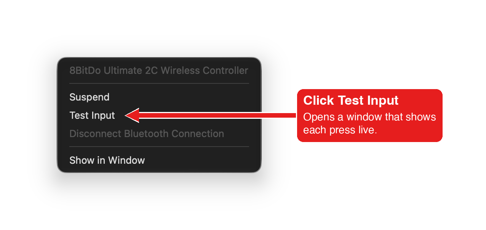
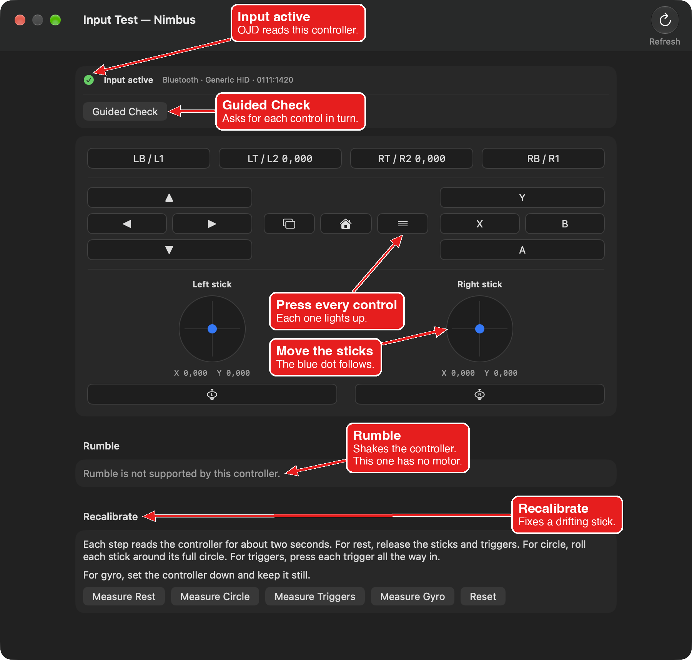

# Testing a Controller

The Input Test window shows live input from a controller and tests rumble and lighting.

Use it after you connect a controller or change a record or profile. Press each control and watch the matching one light up.

## Open the Input Test Window

Click **Controllers** in the sidebar, select a controller, and click **Open Input Test**.

You can also choose **Controller** > **Test Input**, or **Test Input** in the controller's submenu of the menu-bar icon.

Closing the window stops reading input and any running output test.

## Read the Status

The header shows the status, connection, protocol, and controller ID. The status is **Ready**, **Starting...**, **Input active**, **Input interrupted**, **Controller disconnected**, **Input Monitoring permission required**, **Input unavailable**, or **Failed**. For the permission status, see [Permissions](Permissions-and-Security.md#permissions).

## Guided Check

While input is active, **Guided Check** asks you to use each control, one at a time. A step ends when you move the control from where it rests, when another control moves first, or when you click **Skip**. If you hold a control when a step starts, let go of it first, or it doesn't count. Closing the window or changing the controller stops the check.

At the end, a sheet lists what each control did:

- **Save** writes the check document where you choose.
- **Copy** copies it.
- **Open Issue** saves the document to Downloads and opens the support form. Attach the saved file to the issue.
- **Validate** appears after a check in which every control responded. It shows the full text, which holds no serial number, Bluetooth address, user name, or path. Click **Confirm** to open the validation form.

`ojd controller check` runs the check in Terminal. See [Command Reference](Command-Reference.md).

## Use the Groups

The window is one scrolling page with these groups.

### Live Input

Sticks, D-pad, buttons, and triggers show their state. Button names follow the [virtual gamepad kind](Glossary.md#terms).

### Motion Calibration

This group appears for controllers with a gyroscope (a motion sensor that feels turning). Even a still gyroscope reports a little turning, like a scale that shows 2 grams with nothing on it. Keep the controller still while OJD measures that error, called the resting offset. Use **Start Calibration**, **Pause**, and **Reset**. Collection continues after you close the window and needs an enabled [profile](Glossary.md#terms) for the controller. Whether the calibration survives an OJD restart is untested.

### Recalibrate

Use **Recalibrate** when a stick drifts or never reaches full range. Each step reads the controller for about two seconds.

- **Measure Rest**: release the sticks and triggers.
- **Measure Circle**: roll each stick around its full circle.
- **Measure Triggers**: press each trigger all the way in.
- **Measure Gyro**: keep the controller still. A controller without a gyroscope skips this.

OJD stores the values in the record for the controller's model. It applies them to each reading before a profile changes what the control does. **Reset** removes them. `ojd controller calibrate CONTROLLER sticks` does the same in Terminal.

### Rumble

Drag each motor's slider (0 to 255), set **Duration** (100 to 2000 ms, default 300), and click **Test Rumble**. Click **Stop** to end the test early. A controller with no motor shows **Rumble is not supported by this controller.**

### Lighting

This group appears only for a controller with lighting. Set **Player indicator**, **Color**, or **Brightness**, then click **Apply**.

## Further Reading

- [Rumble and Lighting](Playing-Games.md#rumble-and-lighting)
- [Controllers Area](Using-the-App.md#controllers-area)
- [Controller Is Not Detected](Troubleshooting.md#if-a-controller-isnt-detected)
