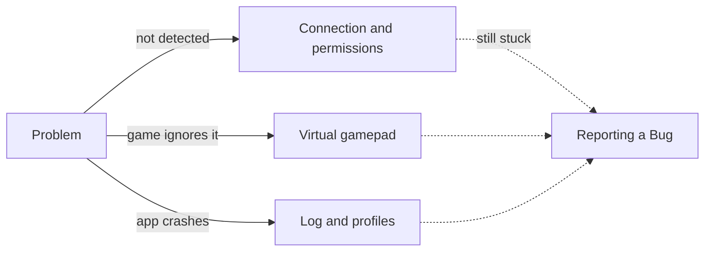
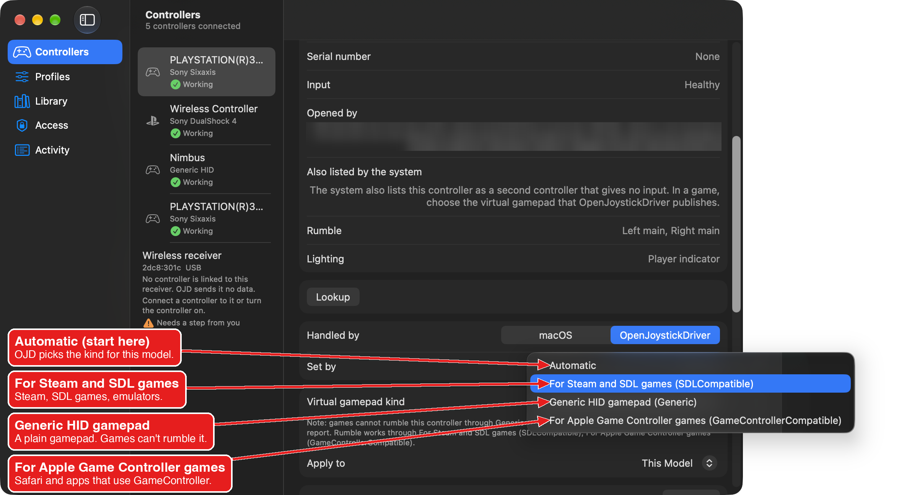
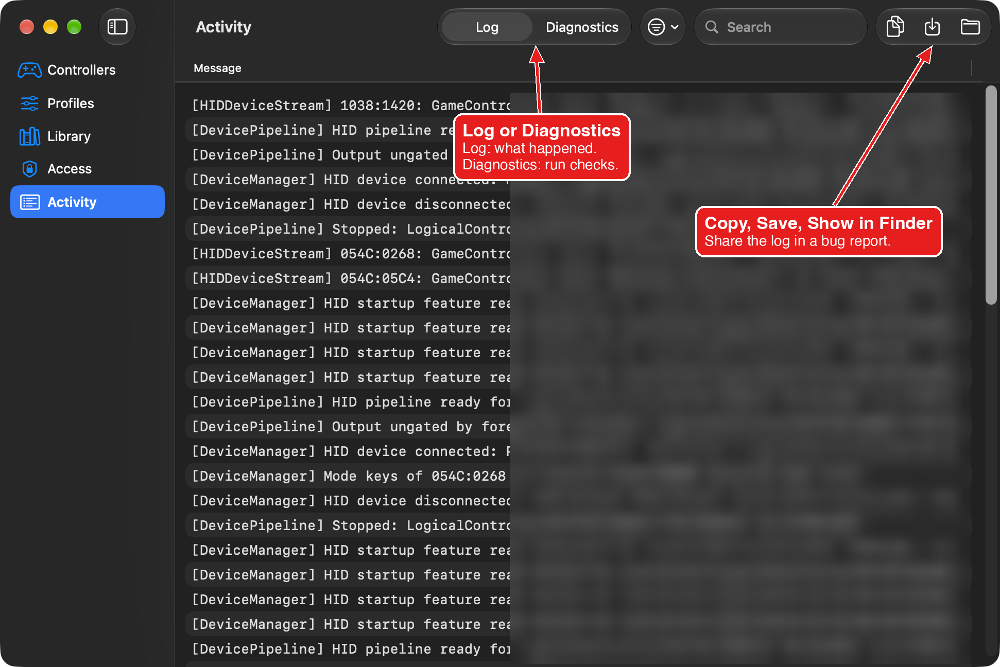

# Troubleshooting

Something is wrong? Find what you see, then follow the steps.



## Contents

- [If a Controller Isn't Detected](#if-a-controller-isnt-detected)
- [Game Does Not See the Controller](#game-does-not-see-the-controller)
- [If the Home Button Opens Games](#if-the-home-button-opens-games)
- [App Crashes or Does Not Start](#app-crashes-or-does-not-start)
- [Further Reading](#further-reading)

## If a Controller Isn't Detected

**What you see:** the controller is missing from **Controllers**.

### Check the Basics


1. Look for OpenJoystickDriver (OJD) in the menu bar. No icon? Open it.
2. Click **Access**. **Input Monitoring** must say **Allowed**. See [Permissions](Permissions-and-Security.md).
3. **Needs attention**? Click **Request...** and allow OJD.
4. Click **Restart OpenJoystickDriver**.
5. Unplug and replug the controller. For Bluetooth, turn it off and on: OJD never reconnects it.

### Check the Controller ID

Each connection (USB, Bluetooth, dongle) has its own ID, like a phone number. [Find yours](Connecting-Controllers.md#finding-your-controller-id), then look for it in [Supported Controllers](Supported-Controllers.md). Not listed? OJD doesn't know it.

### Special Cases

| You see | Do this |
| --- | --- |
| Xbox One or Series controller on USB | It needs the [Xbox USB driver](Glossary.md#terms). Click **Open System Settings** or **Repair Xbox USB Driver** in the banner ([details](Connecting-Controllers.md#xbox-usb-driver)). Still not installed? Run `ojd transport-extension activate`. |
| Clone or fake controller | It may report another ID: [Clone and Fake Controllers](Supported-Controllers.md#clone-and-fake-controllers). |
| Dongle | Try another controller mode. |
| "OpenJoystickDriver cannot reach its service" | Stopped. Run `ojd service start`, then `ojd status`. |
| SDL games see no controllers | Allow **Input Monitoring** and **Accessibility**, then reopen OJD (unconfirmed). |
| "Used by" and an app name | Another app holds it, so `ojd controller list` leaves it out. OJD takes it back when that app lets go. |
| A control seems stuck, or **Needs attention** | Let go of every control, then run `ojd status --json`. |

### Check from the Terminal

Run `ojd status`. Still missing? [Reporting a Bug](Reporting-a-Bug.md).

## Game Does Not See the Controller

**What you see:** OJD shows the controller; the game ignores it.

### Check OJD First


1. Click **Open Input Test** ([Testing a Controller](Testing-a-Controller.md)) and press buttons. Nothing lights up? See [If a Controller Isn't Detected](#if-a-controller-isnt-detected).
2. Click **Access**. **Accessibility** must say **Allowed**, so OJD can hand games the [virtual gamepad](Glossary.md#terms) (a pretend controller).

### Understand Why Apps Differ

The virtual gamepad speaks one [kind](Glossary.md#terms) at a time. Games listen in different "languages":

| App | Understands |
| --- | --- |
| SDL, such as Steam | Xbox-style kind |
| Apple Game Controller, such as Safari and **System Settings** | Game Controller kind only |

Test results: [Game and App Compatibility](Playing-Games.md#game-and-app-compatibility).

### Try a Different Kind



1. Choose **View** > **All Controls**.
2. Click **Controllers**, select the controller, and choose a kind in **Virtual gamepad kind**.
3. Pick **This Model** or **This Controller** in **Apply to**, then retry the game.

### If a Button Does Nothing in Steam

Steam ignores buttons missing from its own map, even if OJD sends them (seen with a DualShock 3 PS button).

1. Run `ojd controller watch CONTROLLER --output` and press the button. Shown? OJD sends it.
2. In Steam, open **Controller Layout** > **Setup Device Inputs**.
3. Press each button when asked, including PS (Guide).

To compare Steam's map with OJD's, run `ojd virtual export-mapping generic`.

If Steam shows the controller as **Used by** Steam in `ojd status`, see [Another App Reads a USB Controller Directly](Known-Issues.md#another-app-reads-a-usb-controller-directly).

### Try a Different Controller Mode

With a Switch Pro mode switch, macOS reads the controller itself and OJD adds no virtual gamepad. One tester saw RPCS3, a browser, and **System Settings** work this way. Other controllers are untried.

## If the Home Button Opens Games

**What you see:** the home button (PS button) opens the Games app, because macOS lists the controller in **System Settings** > **Game Controllers**.

**Fix:** there, under **Home Button**, turn off **Enable Home Button Actions** or pick another app in **Press Home Button to Open**.

## App Crashes or Does Not Start

### Collect Information

Copy the log **before** you reopen OJD.



1. Copy the log in **Activity**, or run:

   ```shell
   ojd log show --lines 200
   ```

2. Report it, with what you did before the crash: [Reporting a Bug](Reporting-a-Bug.md).

### Crash When You Unplug a Controller

Unplugging a USB controller or dongle can crash OJD, not every time. OJD tries to prevent it (unconfirmed). Reopen OJD. Old virtual gamepads still in **System Settings**? Restart OJD. See [Known Issues](Known-Issues.md#unplugging-a-usb-controller-can-crash-the-app).

### Damaged Profile Files

A damaged profile file or `ActiveProfiles.plist` blocks every profile change. `ojd profile recover` repairs both.

#### Repair One Damaged Profile

OJD marks the broken one **Needs attention**. Select it, click **Delete Damaged Profile...**, then click **Delete**.

#### Repair a Damaged Active Profile List

`ActiveProfiles.plist` remembers each controller's profile. If OJD can't read it, **Profiles** shows **Damaged Active Profile List** and no profile is on.

Click **Back Up & Reset Active Profiles...**, then **Back Up & Reset**. Your profiles stay, but none is on. Turn on the ones you want.

#### Find the Backup

OJD copies each file before changing it, next to the file (`~/Library/Application Support/OpenJoystickDriver/Profiles/` for a profile, one folder up for the list) as `FILE.backup-DATE-TIME-ID`. Open it in a text editor to get data back ([Profile File Reference](Profile-File-Reference.md)).

## Further Reading

[Known issues](Known-Issues.md) and [FAQ](FAQ.md).
