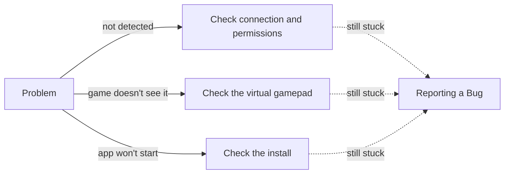
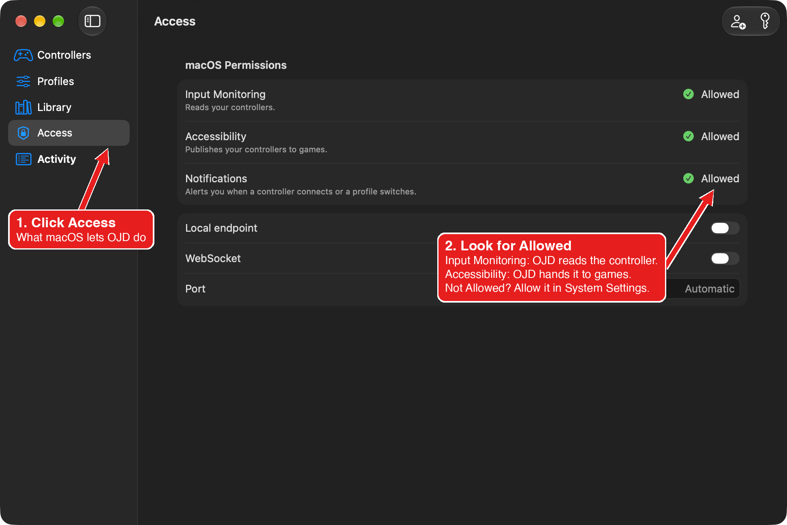
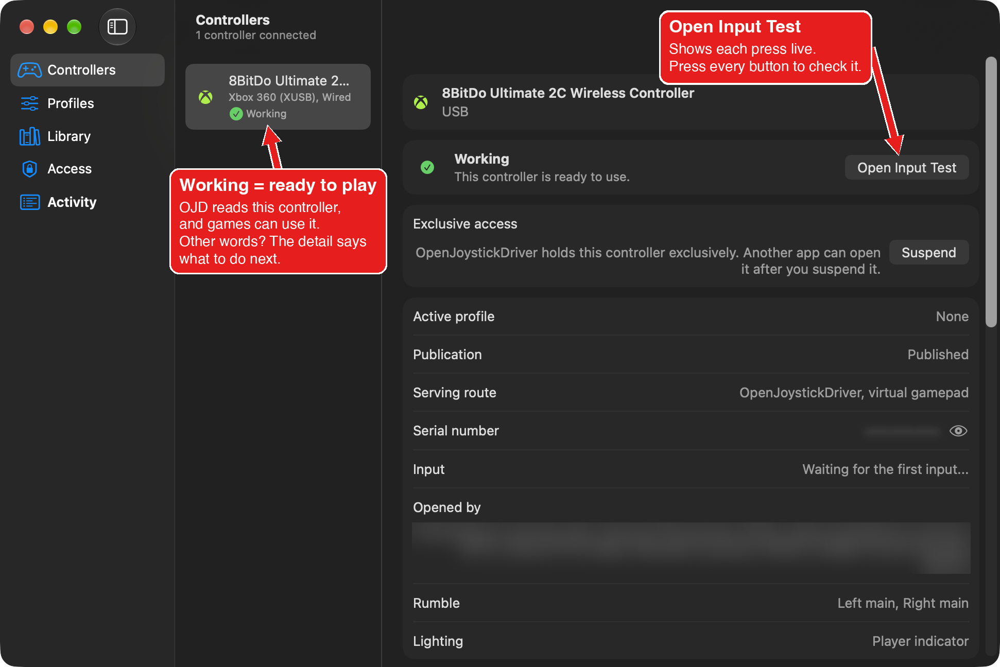

# Troubleshooting

Something is wrong? Start here. Each part says what you see, why it happens, and what to do.



## Contents

- [If a Controller Isn't Detected](#if-a-controller-isnt-detected)
  - [Check the Basics](#check-the-basics)
  - [Check the Controller ID](#check-the-controller-id)
  - [Special Cases](#special-cases)
  - [Check from the Terminal](#check-from-the-terminal)
- [Game Does Not See the Controller](#game-does-not-see-the-controller)
  - [Check OJD First](#check-ojd-first)
  - [Understand Why Apps Differ](#understand-why-apps-differ)
  - [Try a Different Kind](#try-a-different-kind)
  - [If a Button Does Nothing in Steam](#if-a-button-does-nothing-in-steam)
  - [Try a Different Controller Mode](#try-a-different-controller-mode)
- [If the Home Button Opens Games](#if-the-home-button-opens-games)
- [App Crashes or Does Not Start](#app-crashes-or-does-not-start)
  - [Collect Information](#collect-information)
  - [Crash When You Unplug a Controller](#crash-when-you-unplug-a-controller)
  - [Damaged Profile Files](#damaged-profile-files)
- [Further Reading](#further-reading)

## If a Controller Isn't Detected

**What you see:** the controller is missing from the **Controllers** list.

### Check the Basics

OpenJoystickDriver (OJD) must be running, and it needs your OK to read controllers.



1. Look for the OJD icon in the menu bar. No icon? Open OJD from the Applications folder.
2. Click **Access** in the sidebar. **Input Monitoring** must say **Allowed**. Without it, OJD can't read any controller. See [Permissions](Permissions-and-Security.md).
3. If it says **Needs attention**, click **Request...** and allow OJD in **System Settings**.
4. Click **Restart OpenJoystickDriver**.
5. Unplug the controller and plug it back in. For a Bluetooth controller, turn it off and on. OJD never reconnects a Bluetooth controller for you.

### Check the Controller ID

Each way of connecting has its own ID, like a phone number. The same controller has one ID over USB and another over Bluetooth, and a USB dongle has a third.

1. Find your controller's ID. See [Finding Your Controller ID](Connecting-Controllers.md#finding-your-controller-id).
2. Look for that ID in [Supported Controllers](Supported-Controllers.md). If it isn't listed, OJD doesn't know that controller.

### Special Cases

- **Xbox One or Xbox Series controller on USB:** it needs the [Xbox USB driver](Glossary.md#terms). If a banner under the toolbar shows **Open System Settings** or **Repair Xbox USB Driver**, click it. See [Xbox USB Driver](Connecting-Controllers.md#xbox-usb-driver). If the driver still doesn't install, run `ojd transport-extension activate`.
- **Clone or fake controller:** it may report a different ID than the real one. See [Clone and Fake Controllers](Supported-Controllers.md#clone-and-fake-controllers).
- **Dongle:** the dongle may be the problem. Try another controller mode.
- **"OpenJoystickDriver cannot reach its service":** the part of OJD that reads controllers stopped. Run `ojd service start`, then `ojd status`.
- **SDL games see no controllers:** allow **Input Monitoring** and **Accessibility**, then open OJD again. Nobody has confirmed this fix yet.
- **"Used by" and an app name:** another app holds the controller, so OJD can't use it. `ojd controller list` leaves it out. OJD takes it back when that app lets go.
- **A control seems stuck, or the status says Needs attention:** let go of every control, then run `ojd status --json`.

### Check from the Terminal

Run:

```shell
ojd status
```

See [Using the Command Line](Command-Line.md). Still missing? See [Reporting a Bug](Reporting-a-Bug.md).

## Game Does Not See the Controller

**What you see:** OJD shows the controller, but the game ignores it.

### Check OJD First

First check that OJD gets your button presses.



1. Click **Open Input Test** for the controller. See [Testing a Controller](Testing-a-Controller.md).
2. Press some buttons. Nothing lights up? Go to [If a Controller Isn't Detected](#if-a-controller-isnt-detected).
3. Click **Access** in the sidebar. **Accessibility** must say **Allowed**. OJD needs it to hand games the [virtual gamepad](Glossary.md#terms), the pretend controller games read.

### Understand Why Apps Differ

Games listen in different "languages". OJD's virtual gamepad speaks one [kind](Glossary.md#terms) at a time:

- Apps built with SDL, such as Steam, understand the Xbox-style kind.
- Apps built on Apple's Game Controller support, such as Safari and **System Settings**, understand only the Game Controller kind.

So one app can see the controller while another misses it. [Game and App Compatibility](Playing-Games.md#game-and-app-compatibility) lists test results, and none is a promise.

### Try a Different Kind

This shows whether the kind causes the problem. If another kind fixes a game, please report it.


1. Turn on **All Controls**: choose **View** > **All Controls**.
2. Click **Controllers** in the sidebar, then select the controller.
3. Find **Virtual gamepad kind** in the details and choose **Automatic** or one of the three kinds.
4. In **Apply to**, choose **This Model** for every controller of that model, or **This Controller** for this one only.
5. Try the game again.

In one test, Steam with **Generic HID gamepad** was slow and jumpy.

### If a Button Does Nothing in Steam

Steam keeps its own button map for each controller. If the map lacks a button, Steam ignores it even though OJD sends it. The maintainer saw this with the PS button of a DualShock 3.

1. Run `ojd controller watch CONTROLLER --output` and press the button. If the button shows up in the output, OJD sends it.
2. In Steam, open **Controller Layout** for the controller and choose **Setup Device Inputs**.
3. Press each button when Steam asks, including the PS (Guide) button.

After this, Guide and Select worked. To compare Steam's map with OJD's, run `ojd virtual export-mapping generic`.

### Try a Different Controller Mode

Some controllers have a switch for a Switch Pro mode. In that mode macOS reads the controller itself, and OJD doesn't add a virtual gamepad. One tester saw RPCS3, a web browser, and **System Settings** work this way. Nobody has tried it with other controllers.

## If the Home Button Opens Games

**What you see:** you press the home button (the PS button on a PlayStation controller) and the Games app opens.

**Why:** macOS does this for controllers listed in **System Settings** > **Game Controllers**.

**What to do:**

1. Open **System Settings** > **Game Controllers**.
2. Under **Home Button**, turn off **Enable Home Button Actions**, or pick another app in **Press Home Button to Open**.

## App Crashes or Does Not Start

### Collect Information

Copy the log **before** you open OJD again, so the crash details stay in it.


1. Click **Activity** in the sidebar and copy the log, or run:

   ```shell
   ojd log show --lines 200
   ```

2. Write down what you did right before the crash.
3. Report it. See [Reporting a Bug](Reporting-a-Bug.md).

### Crash When You Unplug a Controller

Unplugging a USB controller or dongle can crash OJD, though not every time. OJD tries to prevent this by keeping each controller's macOS plug-in loaded. Nobody has confirmed that this works. Open OJD again. If old virtual gamepads stay listed in **System Settings**, restart OJD. See [Known Issues](Known-Issues.md#unplugging-a-usb-controller-can-crash-the-app).

### Damaged Profile Files

While a profile file or `ActiveProfiles.plist` is damaged, OJD refuses every profile change. To repair both from Terminal, run `ojd profile recover`.

#### Repair One Damaged Profile

OJD keeps your good profiles and marks the broken one **Needs attention**.

1. Select the damaged profile.
2. Click **Delete Damaged Profile...**.
3. In the alert, click **Delete**.

#### Repair a Damaged Active Profile List

`ActiveProfiles.plist` remembers which profile each controller uses. If OJD can't read it, the **Profiles** area shows **Damaged Active Profile List**, and no profile is on.

1. Click **Back Up & Reset Active Profiles...**.
2. In the alert, click **Back Up & Reset**.

Your profiles stay, but none is turned on afterward. Turn on the ones you want again.

#### Find the Backup

OJD copies each file before it changes it. The copy sits next to the file:

- For a profile: `~/Library/Application Support/OpenJoystickDriver/Profiles/`
- For the list: one folder up

The copy is named `FILE.backup-DATE-TIME-ID`. To get data back, open the copy in a text editor. See [Profile File Reference](Profile-File-Reference.md).

## Further Reading

- [Known issues](Known-Issues.md)
- [Frequently asked questions](FAQ.md)
- [Reporting a bug](Reporting-a-Bug.md)
- [Connection types](Connecting-Controllers.md)
- [How games see your controller](Playing-Games.md)
- [Importing and exporting profiles](Remapping-Profiles.md)
