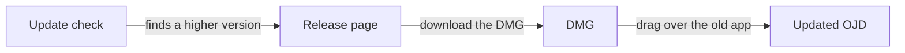
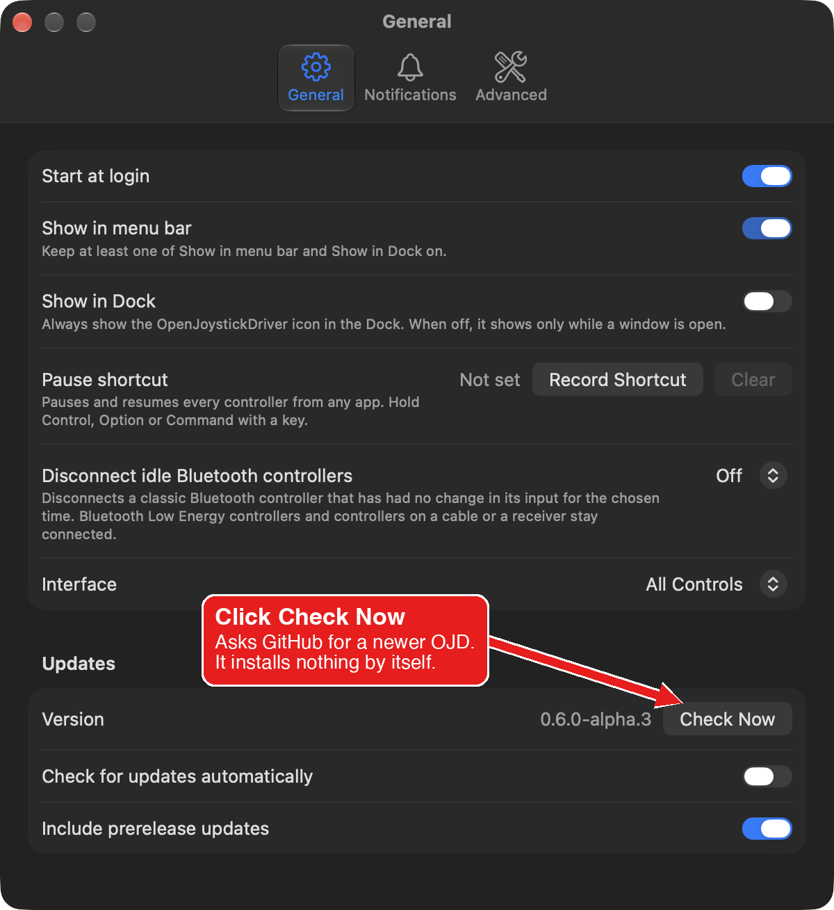
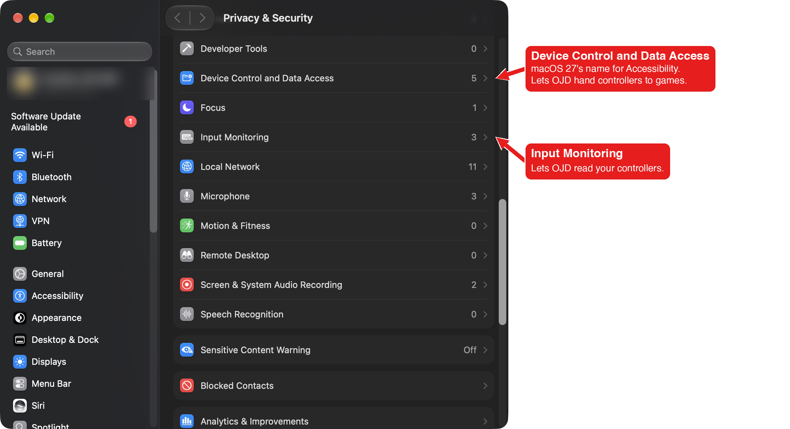

# Updating and Uninstalling

Get a newer OpenJoystickDriver (OJD), or take it off your Mac completely.

- **Who:** anyone who wants a newer OJD, or wants it gone.
- **What:** how update checks work, how to install a newer version, and how to remove everything.
- **When:** when OJD tells you a newer version is out, or whenever you choose.
- **Where:** the [GitHub Releases page](https://github.com/xsyetopz/OpenJoystickDriver/releases), and **Settings** > **General**.
- **Why:** a check only tells you about a version, and you install it yourself.
- **How:** download the DMG and replace the app; to uninstall, follow the list below.



## Contents

- [Update](#update)
  - [How Update Checks Work](#how-update-checks-work)
  - [Release Builds and Tester Builds](#release-builds-and-tester-builds)
  - [Check for Updates](#check-for-updates)
  - [Install an Update](#install-an-update)
  - [Update from an Earlier Alpha](#update-from-an-earlier-alpha)
  - [Get a Fix](#get-a-fix)
- [Uninstall](#uninstall)
  - [Remove the App](#remove-the-app)
  - [Files That Stay on Your Mac](#files-that-stay-on-your-mac)
  - [Remove the Data](#remove-the-data)
- [Further Reading](#further-reading)

## Update

### How Update Checks Work

OJD checks for updates only when you ask. If you turn on **Check for updates automatically** in the **General** pane of **Settings**, it also checks once at each launch and once when you turn the setting on. A check never downloads or installs anything.

A check looks at the version numbers OJD publishes on GitHub and tells you the highest one. It skips prereleases (early test versions) unless you ask for them, so if you run a prerelease, a check finds nothing. To include them, turn on **Include prerelease updates** in **Settings**, or add `--prerelease` to `ojd update check`.

**View Update** opens the version's page in your browser. You install it yourself.

### Release Builds and Tester Builds

A release build is the normal download for everyone. It's a DMG (a disk image you open like a USB stick) that Apple has checked for malware ("notarized"), named `OpenJoystickDriver-VERSION-macOS.dmg`.

A tester build is a checked DMG with a fix that isn't in a release yet. It appears on the [GitHub Releases page](https://github.com/xsyetopz/OpenJoystickDriver/releases) and is linked from the issue it answers. `0.6.0-alpha.2.tester.1` comes after `0.6.0-alpha.2` and before `0.6.0-alpha.3`.

A DMG sent directly holds `OpenJoystickDriver-TESTER-BUILD.txt`, which names the commit and build version.

### Check for Updates

1. Choose OpenJoystickDriver > **Settings...**.
2. In **Updates** on the **General** pane, click **Check Now**.

   

3. If it says **Update available**, click **View Update**.

Or run this in Terminal:

```shell
ojd update check
```

### Install an Update

1. Quit OJD.
2. Open the downloaded DMG.
3. Drag **OpenJoystickDriver** to **Applications**. Click **Replace**.
4. Open OJD from **Applications**.
5. If OJD shows **Repair Xbox USB Driver**, click it.
6. Unplug each USB controller that uses the [Xbox USB driver](Glossary.md#terms), then plug it in again. Otherwise macOS can keep the old driver.

> [!IMPORTANT]
> Open OJD from **Applications**, not from the DMG. macOS turns on the Xbox USB driver only for an app in **Applications**.

Your [profiles](Glossary.md#terms) stay in place.

After an update, **Driver Extensions** in **System Settings** can list the old driver until you restart. You don't need to remove it.

Sometimes macOS forgets that the updated copy is the same app. You see this when **Input Monitoring** or **Accessibility** says OJD is allowed, but OJD reads no controller. Remove OJD from the list and add it again:

1. Choose Apple menu > **System Settings**, then click **Privacy & Security**.
   

2. Click **Input Monitoring** (or **Accessibility**), select **OpenJoystickDriver**, and click **-**.
3. Click **+** and choose **OpenJoystickDriver** in **Applications**.

If OJD isn't in the list, see [If OpenJoystickDriver Isn't in the List](Permissions-and-Security.md#if-openjoystickdriver-isnt-in-the-list).

### Update from an Earlier Alpha

Your profiles and records are saved as files. Their format changed between early versions, and OJD 0.6.0-alpha.3 reads only the newest one: XML property list files (`.plist`) with `apiVersion: openjoystickdriver/v1alpha3`.

- Files from alpha.1 and alpha.2 are JSON and fail with `E5001`.
- A file that isn't an XML property list fails with `E5010`.

You usually don't need to do anything: OJD converts old files each time its service starts. To convert them yourself:

```sh
ojd migrate --dry-run
ojd migrate
```

- `ojd migrate --dry-run` is a rehearsal. It lists what would change and writes nothing.
- `ojd migrate` writes each converted `.plist` beside the old file and puts a copy of the old file in `Migrated/` in the OJD support folder.
- `ojd migrate FOLDER` looks in a folder you name.

Each file gets one result: `Migrated`, `Current`, `Failed`, or `Foreign`. A file it can't convert stays as it was, and the command ends with `E5009`. For `E5001`, the app shows a **Migrate** button next to the error.

A file from 0.5 has no `apiVersion` at all, so OJD can't convert it. Make that profile again. `ojd mod validate` refuses a mod that isn't a `v1alpha3` package.

### Get a Fix

For an unreleased fix, wait for a tester build or build the branch yourself. See [Building From Source](Building-from-Source.md). `CHANGELOG.md` lists what each build contains.

## Uninstall

Dragging the app to the Trash leaves behind a login item, privacy entries, the [Xbox USB driver](Glossary.md#terms), and your data files. Follow the steps in order, because the first steps need the app.

### Remove the App

1. Turn off the login item. In **Settings** > **General**, turn off **Start at login**. Or run this command.

   ```shell
   ojd setting set launchAtLogin false
   ```

2. If you approved the Xbox USB driver, remove it. In **Settings** > **Advanced**, under **Xbox USB Driver**, click **Uninstall**. Or run this command.

   ```shell
   ojd transport-extension deactivate
   ```

3. Click the OJD icon in the menu bar and choose **Quit OpenJoystickDriver**.
4. Drag **OpenJoystickDriver** from **Applications** to the Trash.

The driver commands work only with the copy in `/Applications`.

### Files That Stay on Your Mac

| Item | Location |
| --- | --- |
| Profiles and profile backups | `~/Library/Application Support/OpenJoystickDriver/` |
| Your controller records | `~/Library/Application Support/OpenJoystickDriver/Controllers/` |
| Logs | `~/Library/Logs/OpenJoystickDriver/` |
| Settings | Preferences domain `com.openjoystickdriver` |
| Privacy entries | **System Settings** > **Privacy & Security** |

Files whose names contain `.backup-` are recovery copies.

### Remove the Data

> [!NOTE]
> Export the profiles you want to keep first. See [Importing and exporting profiles](Remapping-Profiles.md#importing-and-exporting-profiles).

1. Move the folder `~/Library/Application Support/OpenJoystickDriver` to the Trash.
2. Move the folder `~/Library/Logs/OpenJoystickDriver` to the Trash.
3. Remove the settings. Run this command.

   ```shell
   defaults delete com.openjoystickdriver
   ```

4. In **System Settings** > **Privacy & Security**, click **Input Monitoring**, select **OpenJoystickDriver**, and click **-**. Do the same in **Accessibility**.

The notification entry stays in **System Settings** > **Notifications**. Whether macOS removes it is untested.

## Further Reading

- [Known issues](Known-Issues.md)
- [Reporting a Bug](Reporting-a-Bug.md)
- [Permissions and Security](Permissions-and-Security.md)
