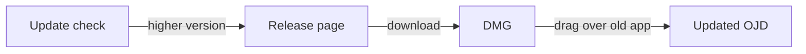

# Updating and Uninstalling

Get the latest OpenJoystickDriver (OJD), or remove it completely. OJD tells you when a version is out. You install it yourself from the [GitHub Releases page](https://github.com/xsyetopz/OpenJoystickDriver/releases).



## Contents

- [Update](#update)
  - [How Update Checks Work](#how-update-checks-work)
  - [Release Builds and Tester Builds](#release-builds-and-tester-builds)
  - [Check for Updates](#check-for-updates)
  - [Install an Update](#install-an-update)
  - [Update from an Earlier Alpha](#update-from-an-earlier-alpha)
  - [Get a Fix](#get-a-fix)
- [Uninstall](#uninstall)
  - [Remove the App](#remove-the-app)
  - [Files That Stay on Your Mac](#files-that-stay-on-your-mac)
  - [Remove the Data](#remove-the-data)

## Update

### How Update Checks Work

OJD checks when you ask, and at launch if **Check for updates automatically** is on in **Settings** > **General**. A check never downloads or installs. It reports the highest version on GitHub. It skips prereleases unless you turn on **Include prerelease updates** or add `--prerelease` to `ojd update check`. On a prerelease, a check finds nothing without it.

### Release Builds and Tester Builds

- Release build: the normal download, `OpenJoystickDriver-VERSION-macOS.dmg`, a disk image like a USB stick. Apple checked it for malware ("notarized").
- Tester build: a checked DMG with a fix not in a release yet. Find it on the Releases page or in the issue it answers. `0.6.0-alpha.2.tester.1` sits between `0.6.0-alpha.2` and `0.6.0-alpha.3`. A DMG sent directly holds `OpenJoystickDriver-TESTER-BUILD.txt`, which names the commit and build.

### Check for Updates

1. In **Settings...** > **General** > **Updates**, click **Check Now**.

   

2. On **Update available**, click **View Update**. Or run `ojd update check`.

### Install an Update

1. Quit OJD.
2. Open the DMG, drag **OpenJoystickDriver** to **Applications**, click **Replace**.
3. Open OJD from **Applications**.
4. If OJD shows **Repair Xbox USB Driver**, click it.
5. Replug each USB controller that uses the [Xbox USB driver](Glossary.md#terms). Otherwise macOS can keep the old driver.

> [!IMPORTANT]
> Open OJD from **Applications**, not the DMG. macOS turns on the Xbox USB driver only for an app in **Applications**.

Your [profiles](Glossary.md#terms), controller records, mod packages, and settings stay in place, because they live outside the app, in `~/Library/Application Support/OpenJoystickDriver/`. Replacing the app replaces everything inside it, including any change you built into your own copy. Want a change such as "treat my controller as an Xbox controller" to survive updates? Put it in a [controller record](Controller-Records.md), not in the source code.

**Driver Extensions** may list the old driver until you restart. Leave it.

If **Input Monitoring** or **Accessibility** says OJD is allowed but OJD reads no controller, macOS has forgotten the updated copy. Remove OJD from the list and add it again:

1. Choose Apple menu > **System Settings**, then **Privacy & Security**.
   

2. Click **Input Monitoring** (or **Accessibility**), select **OpenJoystickDriver**, and click **-**.
3. Click **+** and choose **OpenJoystickDriver** in **Applications**.

Missing? See [If OpenJoystickDriver Isn't in the List](Permissions-and-Security.md#if-openjoystickdriver-isnt-in-the-list).

### Update from an Earlier Alpha

OJD 0.6.0-alpha.3 reads only `.plist` files with `apiVersion: openjoystickdriver/v1alpha3`. JSON from alpha.1 and alpha.2 fails with `E5001`, and any other non-plist file with `E5010`. OJD converts old files at each service start. To do it yourself, rehearse (writes nothing), then run:

```sh
ojd migrate --dry-run
ojd migrate
```

The `.plist` lands beside the old file, which moves to `Migrated/`. An unconvertible file stays as it was, and the command ends with `E5009`. For `E5001`, the app shows a **Migrate** button. More options: [command reference](Command-Reference.md#migrate). A 0.5 file has no `apiVersion`: remake that profile. `ojd mod validate` refuses a mod that isn't a `v1alpha3` package.

### Get a Fix

For an unreleased fix, wait for a tester build or [build the branch](Building-from-Source.md). `CHANGELOG.md` lists each build.

## Uninstall

The Trash alone leaves the login item, privacy entries, [Xbox USB driver](Glossary.md#terms), and your data. Go in order; the first steps need the app.

### Remove the App

1. In **Settings** > **General**, turn off **Start at login**, or run `ojd setting set launchAtLogin false`.
2. If you approved the Xbox USB driver, remove it. Click **Uninstall** under **Xbox USB Driver** in **Settings** > **Advanced**, or run `ojd transport-extension deactivate`. Both work only on the copy in `/Applications`.
3. Choose **Quit OpenJoystickDriver** from the menu bar icon.
4. Drag **OpenJoystickDriver** from **Applications** to the Trash.

### Files That Stay on Your Mac

| Item | Location |
| --- | --- |
| Profiles and profile backups | `~/Library/Application Support/OpenJoystickDriver/` |
| Your controller records | `~/Library/Application Support/OpenJoystickDriver/Controllers/` |
| Logs | `~/Library/Logs/OpenJoystickDriver/` |
| Settings | Preferences domain `com.openjoystickdriver` |
| Privacy entries | **System Settings** > **Privacy & Security** |

Files whose names contain `.backup-` are recovery copies.

### Remove the Data

> [!NOTE]
> Export profiles you want to keep first. See [Importing and exporting profiles](Remapping-Profiles.md#importing-and-exporting-profiles).

1. Trash the Application Support and Logs folders above.
2. Remove the settings:

   ```shell
   defaults delete com.openjoystickdriver
   ```

3. In **Privacy & Security**, remove **OpenJoystickDriver** from **Input Monitoring** and **Accessibility** with **-**.

The **Notifications** entry stays. Whether macOS removes it is untested.
