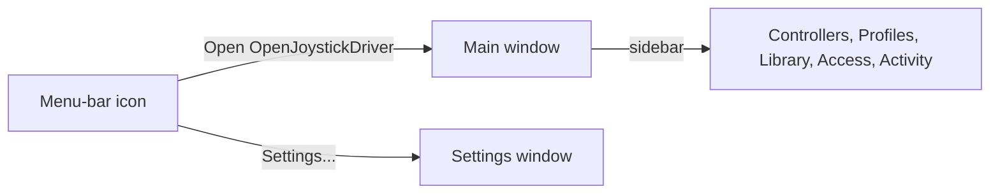
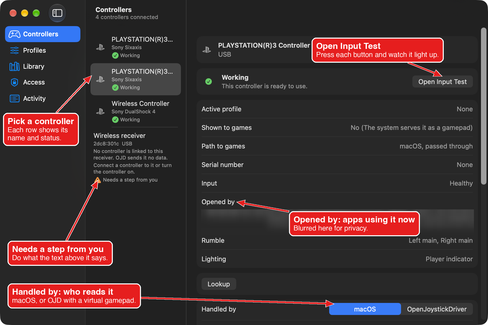
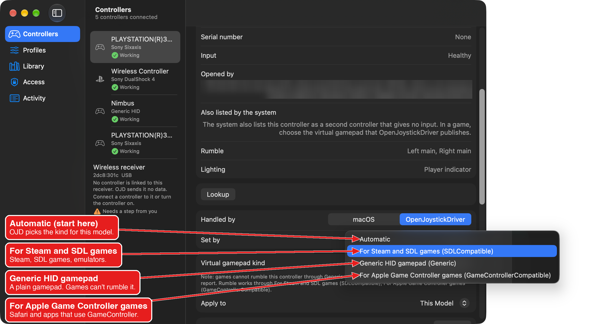
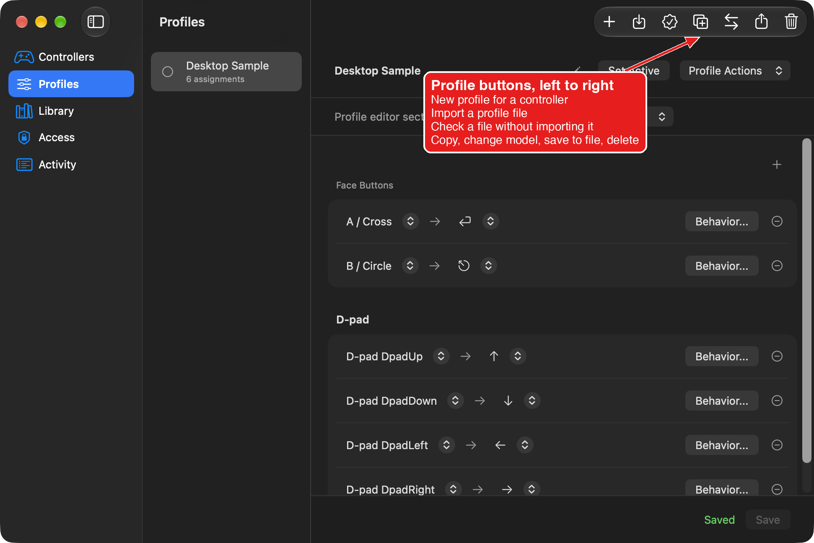
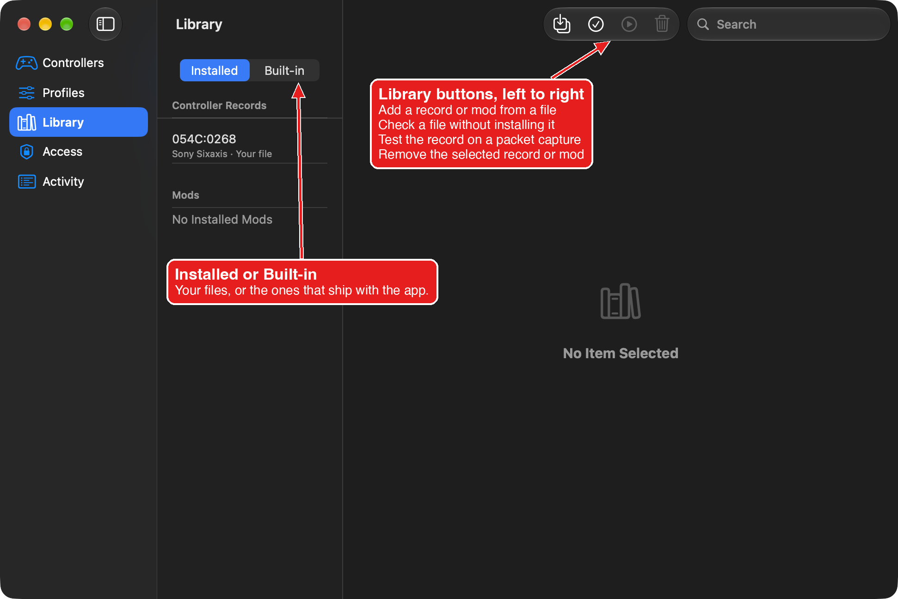
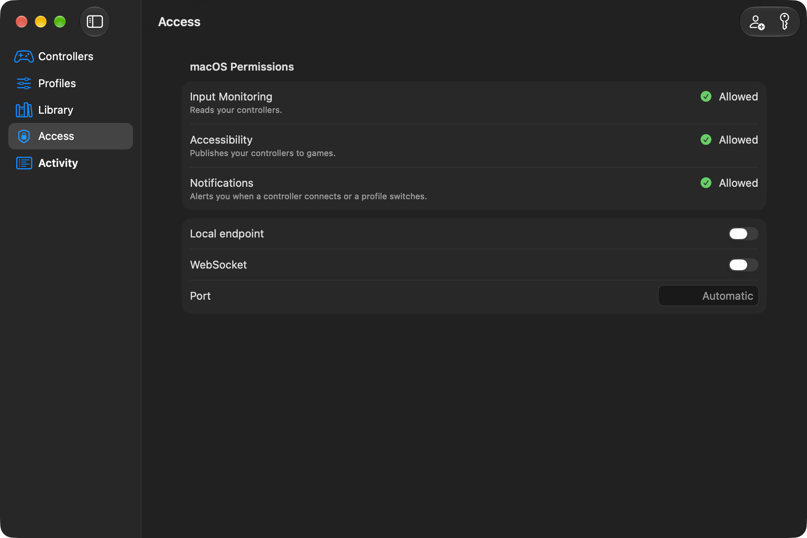
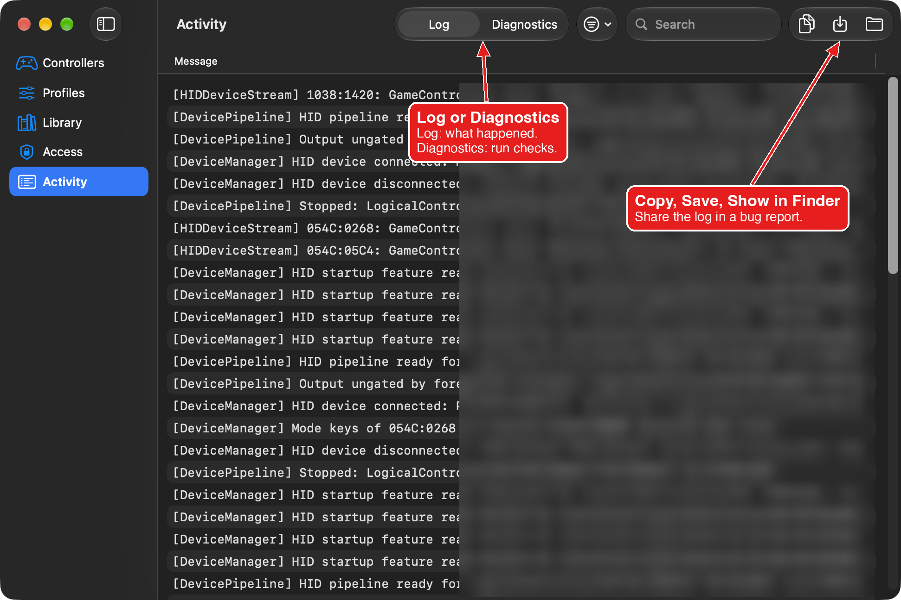
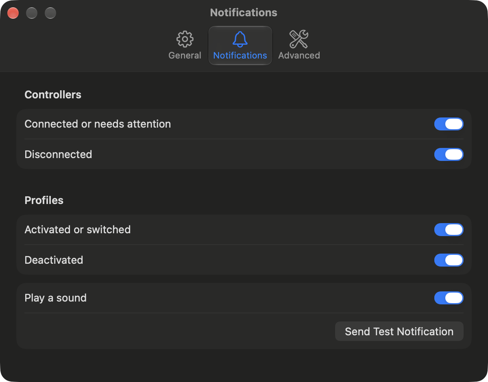
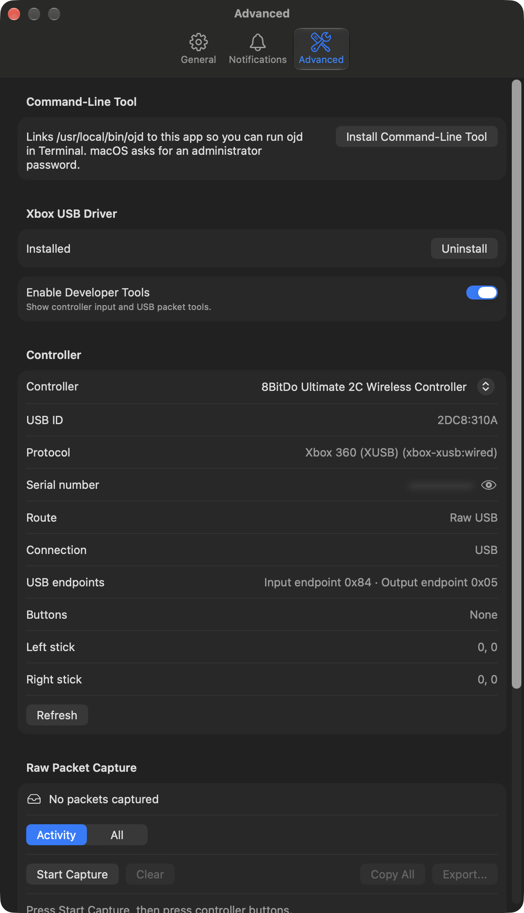

# Using the App

Find your way around OpenJoystickDriver (OJD): the menu-bar menu, the app window, and Settings.

- **Who:** anyone finding their way around OJD.
- **What:** the menu-bar menu, the main window and its areas, and Settings.
- **Where:** the OJD icon in the menu bar.
- **How:** click the icon, then choose **Open OpenJoystickDriver**.

## Contents

- [Menu-Bar Item](#menu-bar-item)
- [Main Window](#main-window)
- [Controllers Area](#controllers-area)
- [Profiles Area](#profiles-area)
- [Library Area](#library-area)
- [Access Area](#access-area)
- [Activity Area](#activity-area)
- [Settings Window](#settings-window)
- [Further Reading](#further-reading)

## Menu-Bar Item

Click the controller icon in the menu bar to see your controllers, choose a [profile](Glossary.md#terms), or open the app. A warning triangle means something needs attention.

The menu shows, from top to bottom:

- A row for each problem. Click **OpenJoystickDriver cannot reach its service** to start the service again. Click **Permission Missing: Accessibility** or **Permission Missing: Input Monitoring** to open the **Access** area.
- A row for each connected controller, with its battery level, active profile, and **Paused** when they apply. With no controller, the menu shows **No Controller Connected**. This is not a problem.
- **Open OpenJoystickDriver**, **Settings...**, and **Quit OpenJoystickDriver**.

Each controller row has a submenu:

- Its profiles, with a checkmark on the active one. Choose **No Profile** to turn the active one off. **More Profiles** opens the **Profiles** area.
- **Pause** stops OJD from using the controller, including its [virtual gamepad](Glossary.md#terms). The item then reads **Resume**.
- **Test Input** opens the Input Test window.
- **Show in Window** opens the controller in the **Controllers** area.
- **Disconnect Bluetooth Connection** asks you to confirm, then leaves the controller off until you connect it again. For a Bluetooth Low Energy controller, turn it off or use Apple menu > **System Settings** > **Bluetooth**.

### Show or Hide the Menu-Bar Icon

Open **Settings**, click **General**, and turn **Show in menu bar** or **Show in Dock** on or off. One stays on. You can also hold Command and drag the icon out of the menu bar. OJD then shows its Dock icon and opens the app window.

### Quit and Reopen

When you quit OJD, your controllers stop working in games. Open OJD from the Applications folder or with Spotlight. OJD opens at login only if **Start at login** is on. Closing the window leaves OJD running.

## Main Window

The sidebar has five areas. Press Command-1 through Command-5 to switch.

| Area | Use It To |
| --- | --- |
| **Controllers** | See your controllers, choose who handles each one, and test them. |
| **Profiles** | Create and edit profiles. |
| **Library** | Install, test, and remove controller records and mods. |
| **Access** | Check permissions and let other programs read your controllers. |
| **Activity** | Read the log, run checks, and look up error codes. |

A banner below the toolbar appears when something stops OJD from working. Click its button to fix it: **Try Again**, **Open System Settings**, **Repair Xbox USB Driver**, or **Grant Access**. For the [Xbox USB driver](Glossary.md#terms), the banner names the controller. **Live updates unavailable** goes away by itself.

### Simple and All Controls

OJD starts in **Simple**, which shows what most people need. **All Controls** adds advanced tools. To switch, choose **View** > **All Controls**, or change **Interface** in **Settings**. Controls marked "(needs the **All Controls** interface)" appear only there. If a hidden setting is changed, **Simple** says so. Click **Show All Controls** to see it.

### Menus

These menus are specific to OJD:

| Menu | Commands |
| --- | --- |
| **File** | **Import Profile...**, **Export Profile...**, **Save Support Report...**. **All Controls** adds record and log commands. |
| **Edit** | **Find** (Command-F) searches the **Library** list or the **Activity** log. |
| **View** | The five areas, **Simple**, **All Controls**, and sidebar and toolbar commands. |
| **Controller** | **Suspend**, **Resume**, **Test Input**, **Disconnect Bluetooth Connection**, and **Show in Window**. |
| **Profile** | Activate, deactivate, create, duplicate, convert, delete, and validate profiles. |
| **Help** | **Copy Support Report**, **Help for This Area**, **Main Window Tour**, and **Report Problem...**. See [Reporting a Bug](Reporting-a-Bug.md). |

## Controllers Area

Select a controller to see its details. If a controller is missing, see [If a Controller Isn't Detected](Troubleshooting.md#if-a-controller-isnt-detected).

### Controller Details

The details show the active profile, the programs that have the controller open, battery, charging state, and cable state. **All Controls** adds **Shown to games** (whether games see a virtual gamepad), **Path to games** (which way the input travels), its protocol, and its serial number (click the eye button to show it).

Other rows appear when they apply:

- **Who can use it** says when only OJD can use the controller. Click **Suspend** to let another app use it.
- **Suspended** means OJD has let go of it. Click **Resume** to take it back.
- **Community verified** lists each [mode](Glossary.md#terms) a tester confirmed, with a link to the report.

Click **Lookup** to find it in [Supported Controllers](Supported-Controllers.md), or **Open Input Test** to test it. See [Testing a Controller](Testing-a-Controller.md).

### Who Handles the Controller

For some controllers, the **Handled by** menu (needs the **All Controls** interface) lets you choose [macOS](Glossary.md#terms) or [OpenJoystickDriver](Glossary.md#terms). The choice works at once and stays after a restart. Controllers OJD reads over USB or through the Xbox USB driver have no menu. See [Choose Who Drives the Controller](Controller-Records.md#choose-who-drives-the-controller).

### Virtual Gamepad Kind

**Virtual gamepad kind** sets what games think your controller is. OJD hands games a pretend controller, the [virtual gamepad](Glossary.md#terms). Games read different kinds, so pick the kind your game reads. The menu appears for a controller that macOS does not handle, with the **All Controls** interface.

| Choice | Pick it when |
| --- | --- |
| **Automatic** | Start here. OJD picks, and shows its pick in brackets. |
| **For Steam and SDL games** | Games on Steam, games built with SDL, and emulators. Games see an Xbox-style pad with rumble. |
| **Generic HID gamepad** | A game reads neither of the others. A plain gamepad with 16 buttons and no rumble. |
| **For Apple Game Controller games** | Safari, and Mac games that use Apple's controller support. Steam and SDL games read nothing from it. |

**Apply to** says where the choice goes. **This Model** covers every controller of the same model. **This Controller** covers only the one you selected. **Reset all overrides** removes your choices. If a change fails, OJD goes back to the earlier kind and shows a message. See [How Games See Your Controller](Playing-Games.md#how-games-see-your-controller).

### Advanced Section

The **Advanced** section (needs the **All Controls** interface) shows the controller's USB VID/PID, endpoints, **Stick deadzone**, calibration readings, and **Recalibrate**. See [Finding Your Controller ID](Connecting-Controllers.md#finding-your-controller-id) and [Recalibrate](Testing-a-Controller.md#recalibrate). With **Enable Developer Tools** on, it also has **Draft Record...** and **Capture Packets...**.

## Profiles Area

Select a profile to edit it. See [Profiles](Remapping-Profiles.md).

## Library Area

The **Library** area (needs the **All Controls** interface) lists installed controller records and mods. A record tells OJD how to read a controller. A mod is a folder of records and profiles.

- Click **Install** to add a record or mod. Click **Check...** first to look it over.
- Click **Remove** to delete an item.
- Click **Test Record...** to play a packet capture through a record.
- Type in **Search** to filter by ID or protocol family.

See [Controller Records](Controller-Records.md) and [Writing Controller Mods](Writing-Controller-Mods.md).

## Access Area

The **Access** area shows what OJD and other programs may do.

### Permissions

Rows show **Input Monitoring**, **Accessibility**, and **Notifications**. A **Keyboard & pointer** row appears while an active profile sends keystrokes or pointer movement. Each row reads **Allowed** or **Needs attention**. For a row that needs attention, click **Request...** or **Open System Settings**. After you allow a permission, click **Restart OpenJoystickDriver**. See [Permissions](Permissions-and-Security.md#permissions).

### Local Endpoint

The local endpoint lets other programs on your Mac, such as a stream overlay or a script, read your controllers. It is off until you turn it on. Its controls need the **All Controls** interface and **Enable Developer Tools**.

- Turn on **Local endpoint** for programs, or **WebSocket** for web pages. OJD asks you to confirm.
- **Programs with Access** lists each allowed program with **Read** or **Control** access. Click **Grant a Program...** to add one, or **Revoke** to remove one.
- **Tokens** lists web page tokens. Click **Create a Token...** and copy the token at once, because OJD shows it only once.
- **Refused Recently** and **Connected Now** list turned-away and open connections.

See [Automating OpenJoystickDriver](Automating-OpenJoystickDriver.md).

## Activity Area

The **Activity** area (needs the **All Controls** interface) has two views:

- **Log** shows the newest line first. Use **Search**, **Filter**, and **Lines** to narrow it. **Show in Finder** opens the log folder.
- **Diagnostics** shows the result of **Run Checks**, one row per check.

To look up an error, choose **Help** > **Explain Error Code...**. See [Error Codes](Error-Codes.md).

## Settings Window

Choose **OpenJoystickDriver** > **Settings...** or press Command-Comma (,). The window has three panes.

### General

- **Start at login** opens OJD in the menu bar when you log in. If macOS asks for approval, allow OpenJoystickDriver under **System Settings** > **General** > **Login Items & Extensions**.
- **Show in menu bar** and **Show in Dock** choose where the icon appears.
- **Pause shortcut** (needs the **All Controls** interface) pauses every controller from any app. Click **Record Shortcut**, then press a key with Control, Option, or Command.
- **Disconnect idle Bluetooth controllers** (needs the **All Controls** interface) disconnects a controller you have not used for 5 to 60 minutes. It is off by default and skips Bluetooth Low Energy controllers and controllers on a cable or receiver.
- **Interface** chooses **Simple** or **All Controls**.
- **Updates**: click **Check Now** to ask GitHub for a later version. **Check for updates automatically** also checks at startup. OJD never installs anything. See [How Update Checks Work](Updating-and-Uninstalling.md#how-update-checks-work).

For Terminal equivalents of these settings, see [Command Reference](Command-Reference.md).

### Notifications

Choose which controller and profile events notify you, and whether to play a sound. Click **Send Test Notification** to check. If macOS blocks notifications, click **Open Notification Settings**.

### Advanced

- **Xbox USB Driver** shows the driver state. **Uninstall** removes it, and Xbox USB controllers stop working until you reinstall. See [Xbox USB Driver](Connecting-Controllers.md#xbox-usb-driver).
- **Command-Line Tool** (needs the **All Controls** interface) installs `ojd` for Terminal. It asks for an administrator password.
- **Enable Developer Tools** (needs the **All Controls** interface) shows tools for controller input and USB packets.

If OJD cannot read its settings file, click **Reset Settings**.

## Further Reading

- [Getting Started](Getting-Started.md)
- [Testing a Controller](Testing-a-Controller.md)
- [Permissions](Permissions-and-Security.md#permissions)
- [If a Controller Isn't Detected](Troubleshooting.md#if-a-controller-isnt-detected)
- [Connecting Controllers](Connecting-Controllers.md)
- [Known Issues](Known-Issues.md)
- [Updating and Uninstalling](Updating-and-Uninstalling.md)
