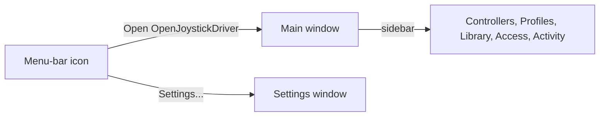
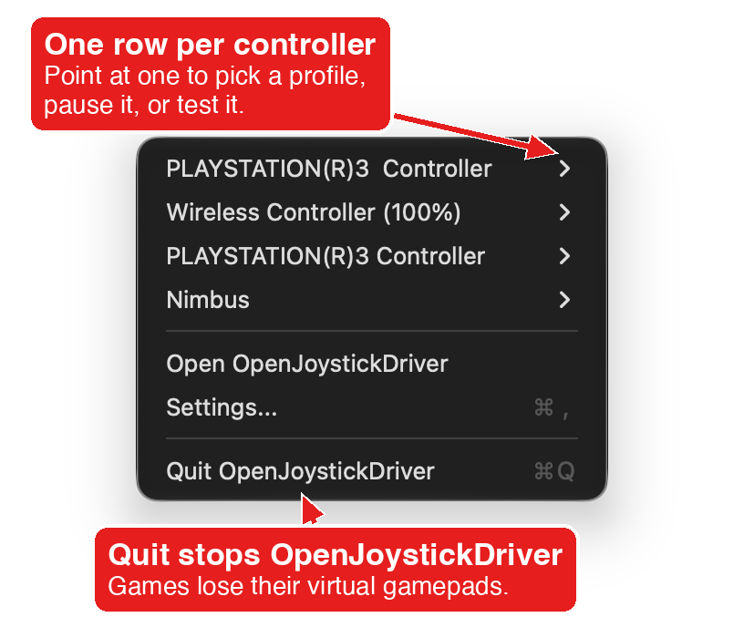
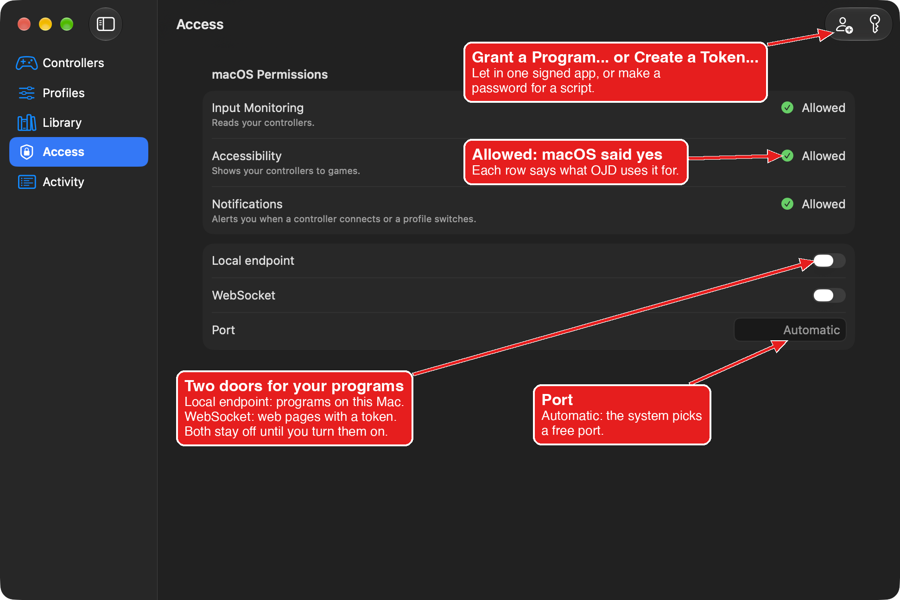
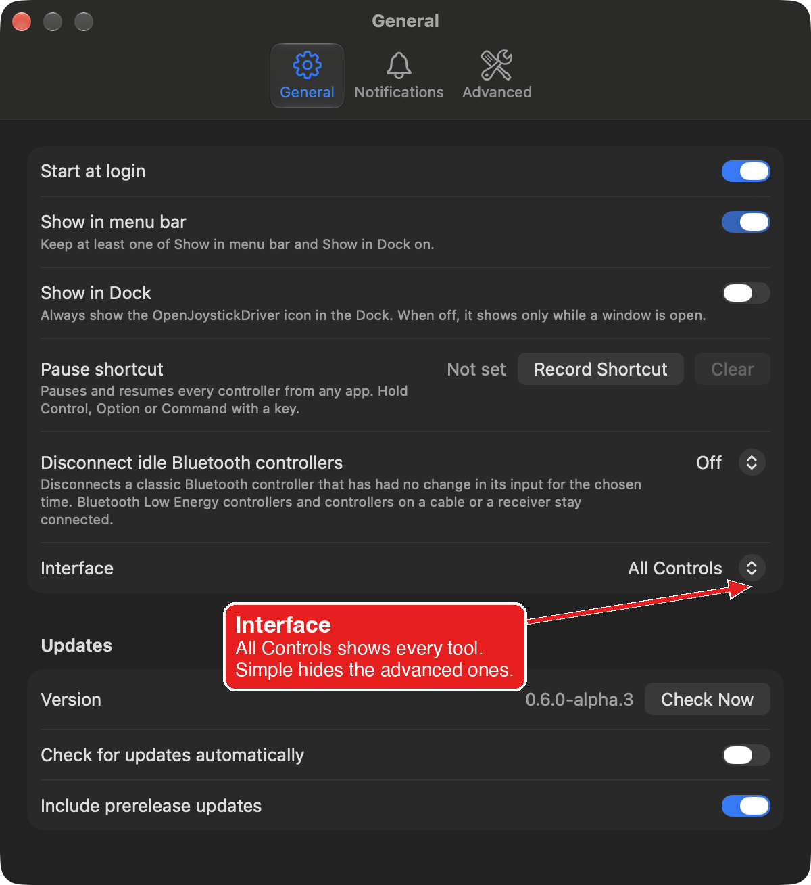

# Using the App

Find your way around OpenJoystickDriver (OJD): the menu-bar menu, the app window, and Settings.

## Contents

- [Menu-Bar Item](#menu-bar-item)
- [Main Window](#main-window)
- [Controllers Area](#controllers-area)
- [Profiles Area](#profiles-area)
- [Library Area](#library-area)
- [Access Area](#access-area)
- [Activity Area](#activity-area)
- [Settings Window](#settings-window)
- [Further Reading](#further-reading)

## Menu-Bar Item

A warning triangle means something needs attention. Menu rows, top to bottom:

- A row for each problem. **OpenJoystickDriver cannot reach its service** restarts it. **Permission Missing: Accessibility** or **Permission Missing: Input Monitoring** opens **Access**.
- A row for each controller, with battery, active profile, and **Paused**. **No Controller Connected** is normal with none plugged in.
- **Open OpenJoystickDriver**, **Settings...**, **Quit OpenJoystickDriver**.

Each controller row has a submenu:

- Its [profiles](Glossary.md#terms), with a checkmark on the active one. **No Profile** turns it off. **More Profiles** opens **Profiles**.
- **Pause** stops OJD from using the controller and its [virtual gamepad](Glossary.md#terms). Then it reads **Resume**.
- **Test Input** opens the Input Test window. **Show in Window** opens **Controllers**.
- **Disconnect Bluetooth Connection** asks you to confirm, then leaves it off until you reconnect. For Bluetooth Low Energy, turn the controller off or use Apple menu > **System Settings** > **Bluetooth**.

### Show or Hide the Menu-Bar Icon

In **Settings** > **General**, turn **Show in menu bar** or **Show in Dock** on or off. One stays on. Command-drag the icon out of the menu bar and OJD shows its Dock icon and opens the window.

### Quit and Reopen

Quit, and games lose your controllers. Reopen from Applications. Closing the window leaves OJD running.

## Main Window

Five areas in the sidebar. Command-1 through Command-5 switch.

| Area | Use It To |
| --- | --- |
| **Controllers** | See, test, and choose who handles each controller. |
| **Profiles** | Create and edit profiles. |
| **Library** | Install, test, and remove controller records and mods. |
| **Access** | Check permissions and let other programs read your controllers. |
| **Activity** | Read the log, run checks, and look up error codes. |

A banner appears when something stops OJD, such as a missing permission or the [Xbox USB driver](Glossary.md#terms). Click its button: **Try Again**, **Open System Settings**, **Repair Xbox USB Driver**, or **Grant Access**. **Live updates unavailable** goes away by itself.

### Simple and All Controls

**Simple** shows what most people need. **All Controls** adds advanced tools. Choose **View** > **All Controls**, or change **Interface** in **Settings**. Items marked "(needs All Controls)" appear only there. If a hidden setting changed, click **Show All Controls**.

### Menus

**File** imports and exports profiles. **Edit** has **Find** (Command-F). **View** switches areas and **Simple** or **All Controls**. **Help** has **Copy Support Report**, **Help for This Area**, **Main Window Tour**, and **Report Problem...**: see [Reporting a Bug](Reporting-a-Bug.md).

## Controllers Area

Select a controller to see its profile, programs using it, battery, charging, and cable state. Missing? See [If a Controller Isn't Detected](Troubleshooting.md#if-a-controller-isnt-detected).

**All Controls** adds **Shown to games**, **Path to games**, the protocol, and the serial number (eye button). A controller with a **Handled by** switch leaves out **Path to games**, and leaves out **Shown to games** while macOS handles it, because the switch says who handles it. Other rows:

- **Who can use it**: only OJD can. **Suspend** lets another app use it.
- **Suspended**: OJD let go. **Resume** takes it back.
- **Community verified**: each [mode](Glossary.md#terms) a tester confirmed, with a report link.

**Look Up** finds it in [Supported Controllers](Supported-Controllers.md). **Open Input Test** tests it. See [Testing a Controller](Testing-a-Controller.md).

### Who Handles the Controller

For some controllers, **Handled by** (needs All Controls) lets you choose [macOS](Glossary.md#terms) or [OpenJoystickDriver](Glossary.md#terms). It works at once and persists. Controllers read over USB or the Xbox USB driver have no menu. See [Choose Who Drives the Controller](Controller-Records.md#choose-who-drives-the-controller).

### Virtual Gamepad Kind

**Virtual gamepad kind** sets which pretend controller games see. Pick the kind your game reads. The menu appears for a controller macOS doesn't handle, with All Controls.

| Choice | Pick it when |
| --- | --- |
| **Automatic** | Start here. OJD picks and shows its pick in brackets. |
| **For Steam and SDL games** | Steam games, SDL games, and emulators. Xbox-style pad with rumble. |
| **Generic HID gamepad** | A game reads neither of the others. 16 buttons, no rumble. |
| **For Apple Game Controller games** | Safari and Mac games with Apple's controller support. Steam and SDL games read nothing from it. |

**Apply to**: **This Model** covers every controller of that model, **This Controller** only the selected one. **Reset all overrides** removes your choices. A failed change keeps the earlier kind. See [How Games See Your Controller](Playing-Games.md#how-games-see-your-controller).

### Advanced Section

The **Advanced** section (needs All Controls) shows USB VID/PID, endpoints, **Stick deadzone**, calibration, and **Recalibrate**. See [Finding Your Controller ID](Connecting-Controllers.md#finding-your-controller-id) and [Recalibrate](Testing-a-Controller.md#recalibrate). With **Enable Developer Tools** on, it also has **Draft Record...** and **Capture Packets...**.

## Profiles Area

Select a profile to edit it: [Profiles](Remapping-Profiles.md).

## Library Area

The **Library** area (needs All Controls) lists controller records (how OJD reads a controller) and mods (folders of records and profiles).

**Install** adds one (click **Check...** first). **Remove** deletes it. **Test Record...** plays a packet capture through a record. **Search** filters by ID or protocol family.

See [Controller Records](Controller-Records.md) and [Writing Controller Mods](Writing-Controller-Mods.md).

## Access Area

### Permissions

Rows show **Input Monitoring**, **Accessibility**, **Notifications**, and **Keyboard & pointer** (while an active profile sends keys or pointer movement). **Needs attention**? Click **Request...** or **Open System Settings**, then **Restart OpenJoystickDriver**. See [Permissions](Permissions-and-Security.md#permissions).

### Local Endpoint

The local endpoint lets other programs on your Mac, such as a stream overlay, read your controllers. It's off until you turn it on. Its controls need All Controls and **Enable Developer Tools**.

- Turn on **Local endpoint** for programs or **WebSocket** for web pages, and confirm.
- **Programs with Access** lists each program with **Read** or **Control**. **Grant a Program...** adds one. **Revoke** removes one.
- **Tokens** lists web page tokens. **Create a Token...** shows the token once, so copy it.
- **Refused Recently** and **Connected Now** list turned-away and open connections.

See [Automating OpenJoystickDriver](Automating-OpenJoystickDriver.md).

## Activity Area

The **Activity** area (needs All Controls) has two views:

- **Log**, newest first. Narrow with **Search**, **Filter**, **Lines**.
- **Diagnostics**: one row per check after **Run Checks**.

To look up an error, choose **Help** > **Explain Error Code...**. See [Error Codes](Error-Codes.md).

## Settings Window

Choose **OpenJoystickDriver** > **Settings...** or press Command-Comma (,). It has three panes. For Terminal equivalents, see [Command Reference](Command-Reference.md).

### General

- **Open at login**: see [Allow the Login Item](Getting-Started.md#allow-the-login-item).
- **Pause shortcut** (needs All Controls) pauses every controller from any app. Click **Record Shortcut**, then press a key with Control, Option, or Command.
- **Disconnect idle Bluetooth controllers** (needs All Controls) disconnects one idle for 5 to 60 minutes. Off by default. It skips Bluetooth Low Energy, cable, and receiver controllers.
- **Updates**: **Check Now** asks GitHub for a later version, and **Check for updates automatically** also checks at startup. OJD installs nothing. See [How Update Checks Work](Updating-and-Uninstalling.md#how-update-checks-work).

### Notifications

Choose which events notify you and play a sound. Blocked by macOS? Click **Open Notification Settings**.

### Advanced

- **Xbox USB Driver** shows the driver state. **Uninstall** removes it, and Xbox USB controllers stop working until you reinstall. See [Xbox USB Driver](Connecting-Controllers.md#xbox-usb-driver).
- **Command-Line Tool** (needs All Controls) installs `ojd`. It asks for an administrator password.
- **Enable Developer Tools** (needs All Controls) shows tools for controller input and USB packets.

If OJD cannot read its settings file, click **Reset Settings**.

## Further Reading

- [Getting Started](Getting-Started.md)
- [Testing a Controller](Testing-a-Controller.md)
- [Updating and Uninstalling](Updating-and-Uninstalling.md)
