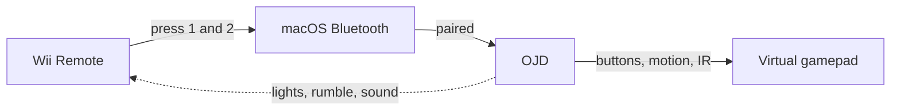
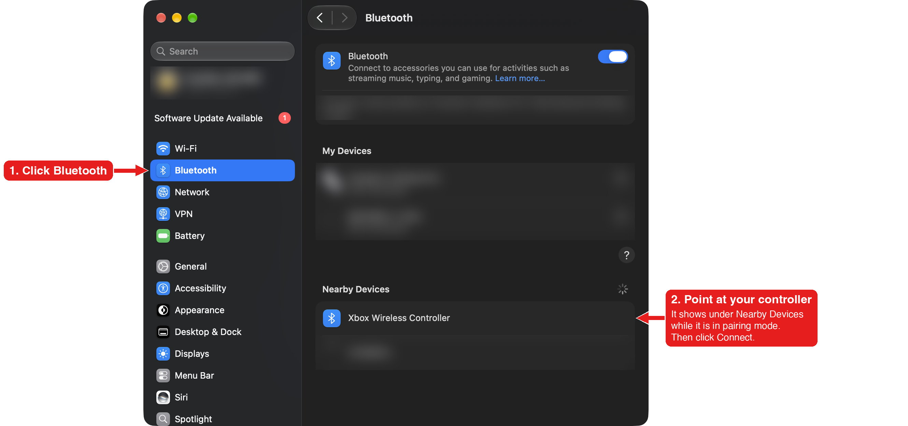

# Wii Remote

Connect a Wii Remote to OpenJoystickDriver (OJD), and see what OJD reads from it and what OJD can make it do (lights, rumble, sound).

macOS pairs the remote, but games can't read it without OJD. To pair, open Bluetooth settings and press 1 and 2 together. The remote then shows up in the **Controllers** area.



## Contents

- [What OJD Drives](#what-ojd-drives)
- [Pair the Remote](#pair-the-remote)
- [Reconnect the Remote](#reconnect-the-remote)
- [Buttons, Motion, and Battery](#buttons-motion-and-battery)
- [Extensions](#extensions)
- [LEDs and Rumble](#leds-and-rumble)
- [IR Pointer](#ir-pointer)
- [Speaker](#speaker)
- [Disconnect the Remote](#disconnect-the-remote)
- [Turn the Remote Off](#turn-the-remote-off)
- [Further Reading](#further-reading)

## What OJD Drives

OJD has two Wii Remote records: `057E:0306` (product string `Nintendo RVL-CNT-01`) and `057E:0330` (`Nintendo RVL-CNT-01-TR`). Both use the `NintendoWii` protocol.

A record matches by product string. OJD doesn't drive the Wii Balance Board or the Wii U Pro Controller, which share an ID with a remote.

No test on a real remote has confirmed these records, so they are Unverified. See [Supported Controllers](Supported-Controllers.md). Nothing on this page is verified on a real remote unless the text says so.

## Pair the Remote

macOS pairs the remote over Bluetooth. OJD reads it once macOS lists it as connected.


1. Choose Apple menu > **System Settings**, then click **Bluetooth**.
2. Press the 1 and 2 buttons together, or press the red SYNC button in the battery compartment.
3. Select the remote when it appears.



Which method works on which macOS version is untested. If pairing fails, see [Known Issues](Known-Issues.md#a-wii-remote-may-not-pair-with-macos).

## Reconnect the Remote

OJD never reconnects a Bluetooth controller by itself. Press a button on a paired remote to connect it.

Each connection starts a session. OJD reads the remote's status and accelerometer calibration, and turns the IR camera on if the active [profile](Glossary.md#terms) binds the pointer.

## Buttons, Motion, and Battery

| Remote button | Control |
| --- | --- |
| A | `South` |
| B | `East` |
| 1 | `West` |
| 2 | `North` |
| Minus | `Back` |
| Plus | `Start` |
| Home | `Guide` |
| D-pad | `DpadUp`, `DpadDown`, `DpadLeft`, `DpadRight` |

The accelerometer is a sensor that feels tilting and shaking. It reaches OJD as motion samples. Only the Motion Plus extension adds a gyroscope. OJD shows the battery level as a percentage.

## Extensions

OJD reads the type and data of a plugged-in extension. Unplugging one returns its controls to neutral.

| Extension | What OJD reads |
| --- | --- |
| Nunchuk | Stick as `LeftStickX` and `LeftStickY`, C as `LeftShoulder`, Z as `LeftTrigger`, accelerometer |
| Classic Controller and Classic Controller Pro | Both sticks, buttons, D-pad |

Keep the sticks at rest when you plug an extension in. OJD takes their centers from the first sample.

OJD also decodes Motion Plus gyroscope frames. Keep the remote still after it connects, because OJD measures a rest offset. The Motion Plus path is untested.

OJD doesn't decode an unknown extension. If it can't read one, it reports `ExtensionHandshakeFailed`. Unplug the extension and plug it in again.

## LEDs and Rumble

OJD sets the four player LEDs and rumble. Both are untested on a real remote. To set the LEDs, run:

```shell
ojd controller player CONTROLLER 1|2|3|4|off
```

Player 1 lights the first LED, and so on. A profile can use the target `physical:player:1`.

Rumble is on or off. `ojd controller rumble CONTROLLER` runs it for a set time, and a `physical:rumble` target runs it while a control is held.

## IR Pointer

The remote has a small infrared (IR) camera in its tip. It sees the two glowing points of a sensor bar under your screen and works out where you're pointing. The camera runs only while the active profile binds `PointerX` or `PointerY` as a source. Otherwise the remote reports buttons and the accelerometer (report mode `0x31`), and the camera stays off.

When such a profile becomes active, OJD sets up the camera with seven register writes at least `irWriteIntervalMs` (50 ms) apart, then switches to report mode `0x37`. When no profile binds the pointer, OJD turns the camera off and the pointer returns to neutral.

The pointer is the midpoint of the two largest IR points (up to four, on a 1024 by 768 grid), turned by the remote's roll and mirrored. `PointerX` and `PointerY` run from -1 to 1, with Y positive down. `PointerTracking` is on while two points are visible. With fewer, the pointer keeps its last values.

The pointer has no smoothing and no screen calibration. As a mouse source, its distance from center sets the speed. OJD rejects a pointer binding to a `gamepad:axis:` target, because [virtual gamepads](Glossary.md#terms) have no pointer controls.

IR setup, pointer signs, and sensitivity are untested on hardware. A test confirmed that these commands move the mouse:

```shell
ojd binding set PROFILE axis:pointer-x move:x
ojd binding set PROFILE axis:pointer-y move:y
```

To place the cursor where the remote points, bind to the absolute destination, which maps the pointer across the main display. Hardware tests are missing:

```shell
ojd binding set PROFILE axis:pointer-x position:x
ojd binding set PROFILE axis:pointer-y position:y
```

See [Bindings and Actions](Bindings-and-Actions.md).

## Speaker

OJD plays a sound file on the remote's speaker. The speaker is low quality (mono, 6000 samples per second) and untested on a real remote. To play a file, run:

```shell
ojd controller speaker play CONTROLLER FILE [--volume 0-1]
```

`FILE` must be an uncompressed PCM WAV file with 8, 16, 24, or 32 bits per sample. `--volume` defaults to 1. OJD cuts a clip after `speakerMaxSeconds` (default 10, range 1 to 60). To stop a clip, run:

```shell
ojd controller speaker stop CONTROLLER
```

Without a speaker, the command fails with `E2038`. With an unsupported file, it fails with `E2039`.

## Disconnect the Remote

To close the Bluetooth connection, run:

```shell
ojd controller disconnect CONTROLLER
```

The remote stays paired and reconnects when you press a button. You can also select it in **Controllers** and click **Disconnect Bluetooth Connection**. To remove the pairing, use **System Settings** > **Bluetooth**.

## Turn the Remote Off

OJD can't turn the remote off, because no public report does that. To close the connection, see [Disconnect the Remote](#disconnect-the-remote).

## Further Reading

- [Connecting Controllers](Connecting-Controllers.md)
- [Supported Controllers](Supported-Controllers.md)
- [Known Issues](Known-Issues.md)
- [Controller Records](Controller-Records.md)
- [Bindings and Actions](Bindings-and-Actions.md)
