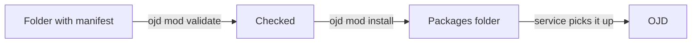
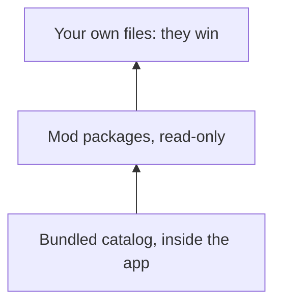
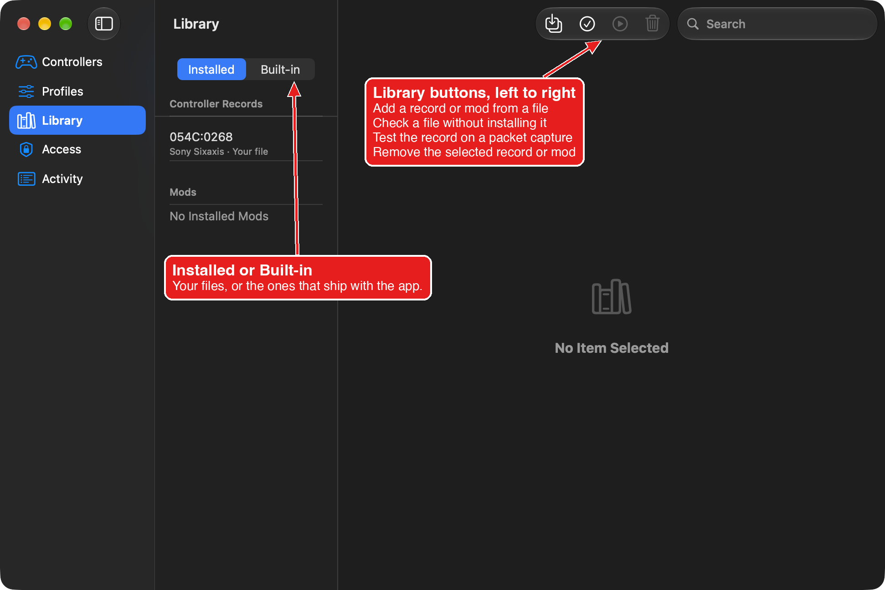

# Writing Controller Mods

A mod package is a folder of files that teaches OJD about a controller, like an add-on pack for a game. You make it once and share it. Anyone can install it with one command and remove it again. It changes nothing inside the signed app.

> [!IMPORTANT]
> Apple signs the list of products that the [Xbox USB driver](Glossary.md#terms) claims. A mod package can't add a controller to that list.

A mod package is a folder of records and profiles with a manifest, for sharing controller support with others. One command adds or removes it from `~/Library/Application Support/OpenJoystickDriver/Packages`, and the signed app stays untouched. Write the manifest, then run `ojd mod validate` and `ojd mod install`.



## Contents

- [Package Layout](#package-layout)
- [The Manifest](#the-manifest)
- [Precedence and Clashes](#precedence-and-clashes)
- [Package Profiles Are Read-Only](#package-profiles-are-read-only)
- [Manage Packages With ojd mod](#manage-packages-with-ojd-mod)
- [Further Reading](#further-reading)

## Package Layout

A package adds files to the ones OpenJoystickDriver (OJD) already reads. It holds only settings files, never programs, so it can't run anything on your Mac. A record for a raw-USB controller works only when macOS lets OJD open the device.

A package is a folder with a `mod.plist` manifest and up to four subfolders:

```text
ojd-sample/
  mod.plist
  Controllers/1209-0001.plist
  Profiles/sample-pad.plist
  VirtualDevices/1209-0001.plist
```

- `Controllers/` holds [controller records](Controller-Records.md). Name a `Controller` file `vvvv-pppp.plist` (lowercase hexadecimal). Name a `ControllerPatch` file `vvvv-pppp.patch.plist`, `model-vvvv-pppp.patch.plist`, or `all.patch.plist`.
- `Profiles/` holds [profiles](Glossary.md#terms) ([format](Profile-File-Reference.md)).
- `VirtualDevices/` holds `VirtualDevice` files, which choose the [virtual gamepad](Glossary.md#terms) that games see. Name each file `vvvv-pppp.plist` for a model, or `vvvv-pppp-U-UNIT.plist` for one controller (`UNIT` is the 16-character unit ID from `ojd controller show`).
- `Protocols/` holds protocol descriptions that `Controller` files can name. Name each file `FamilyName.plist` after its UpperCamelCase family. See [Define a Family With a Description](Controller-Records.md#define-a-family-with-a-description).

The sample package `ojd-sample` is in [`docs/sdk/sample`](../docs/sdk/sample). It adds a generic HID pad, a Start-to-space profile, and a virtual gamepad. Its ID `1209:0001` is a pid.codes test ID. In a package you share, use real vendor and product numbers (VID and PID).

Every file is an XML property list. `plutil -lint FILE.plist` checks one.

OJD refuses any file, folder, or link outside the layout. It skips hidden and `.js` files and never runs or copies a script. To make documents with a script, use [`ojd generate`](Generating-Documents-with-Scripts.md).

## The Manifest

`mod.plist` names the package and lists every file. This is the sample manifest:

```xml
<?xml version="1.0" encoding="UTF-8"?>
<!DOCTYPE plist PUBLIC "-//Apple//DTD PLIST 1.0//EN" "http://www.apple.com/DTDs/PropertyList-1.0.dtd">
<plist version="1.0">
<dict>
 <key>apiVersion</key>
 <string>openjoystickdriver/v1alpha3</string>
 <key>author</key>
 <string>OpenJoystickDriver</string>
 <key>controllers</key>
 <array>
  <string>1209-0001.plist</string>
 </array>
 <key>kind</key>
 <string>ModPackage</string>
 <key>name</key>
 <string>ojd-sample</string>
 <key>profiles</key>
 <array>
  <string>sample-pad.plist</string>
 </array>
 <key>requires</key>
 <dict>
  <key>below</key>
  <string>0.7.0</string>
  <key>minimum</key>
  <string>0.6.0-alpha.1</string>
 </dict>
 <key>version</key>
 <string>1.0.0</string>
 <key>virtualDevices</key>
 <array>
  <string>1209-0001.plist</string>
 </array>
</dict>
</plist>
```

- `apiVersion`: `openjoystickdriver/v1alpha3`. OJD rejects any other version.
- `kind`: `ModPackage`.
- `name`: Lowercase letters, digits, and hyphens.
- `version`: SemVer without a `v` prefix.
- `author`: Non-empty text.
- `requires`: The OJD versions the package runs on. `minimum` is the first version. `below` is the first version too high (optional). Prereleases follow SemVer order.
- `controllers`, `patches`: The `Controller` and `ControllerPatch` files in `Controllers/`.
- `profiles`, `virtualDevices`: The files in `Profiles/` and `VirtualDevices/`.
- `protocols`: The files in `Protocols/`. OJD refuses a file with E5002 or E5003 when its family is built in or its file name isn't its family name. It also refuses one that sets no display name or no `defaults.input.layouts`.

An included list must name a file, and at least one list must be included. OJD refuses a `mod.plist` with any other key, such as `records` or `personas`, with E4001. It refuses a `Controller` file under `patches` or a `ControllerPatch` file under `controllers` with E4003.

Every file in a subfolder must be in the manifest, and every file in the manifest must be in its subfolder. Otherwise OJD refuses the package. Each listed file must be valid for its kind.

OJD skips a package whose `requires` leaves out the running version. `ojd mod list` shows E4002. A development build has no SemVer version. It uses every package, but `ojd mod validate` and `ojd mod install` refuse every package on it.

## Precedence and Clashes

A package is a read-only layer between the bundled catalog and your own files. A package `Controller` file is for a model with no bundled record. A package `ControllerPatch` changes a bundled or packaged record. For the same model, your files win over a package, and your `ControllerPatch` wins over the package record and package patches.

Think of three stacked sheets of tracing paper. OJD reads from the bottom up, and the top sheet wins where they overlap:



- `ojd mod install` and `ojd mod validate` refuse a package whose controller, patch, or virtual gamepad covers a model that your files or another package hold. They also refuse a protocol description with a file name already held, and a profile with an ID or name already held. The code is E4004. `--force` does not override it.
- A clash can appear after install, such as when you add a record later. Your file wins. Among packages, the first by name wins. `ojd record list` names each ignored package record and the reason. OJD doesn't report an ignored package profile. `ojd status` and `ojd diagnose` list each ignored virtual gamepad file.
- If you remove a package that defines a model your `ControllerPatch` patches, OJD lists the patch as a problem and skips it.

## Package Profiles Are Read-Only

You can activate a profile that a package ships, but not change it. OJD refuses a change with E3029. Duplicate the profile and edit the copy.

## Manage Packages With ojd mod

These commands need no running service. The running service watches `~/Library/Application Support/OpenJoystickDriver/Packages` and applies changes without a restart.

```text
ojd mod validate FOLDER
ojd mod install FOLDER [--force] [--dry-run]
ojd mod list
ojd mod remove NAME [--force] [--dry-run]
```

- `mod validate`: Checks the manifest, `requires`, the files, and clashes without installing. It exits with code 1 and the E4xxx or E5001 code when it refuses the package.
- `mod install`: Checks the package and copies it to `Packages/NAME`. An installed package of the same name gives E4005 unless you pass `--force`. `--force` never overrides `requires`, a clash, or an invalid file. `--dry-run` writes nothing.
- `mod list`: Lists installed packages with version, author, and files. An unused package shows its reason and code.
- `mod remove`: Deletes only that package's folder. It asks first on a terminal, and needs `--force` otherwise. It exits with code 1 and E4006 when the package isn't installed. `--dry-run` deletes nothing.

You can add and remove a package in the **Library** area of the app, too:



To try the sample, run `ojd mod validate` and `ojd mod install` with the sample folder path. Then run `ojd mod list`, and `ojd mod remove ojd-sample` to clean up.

[Error Codes](Error-Codes.md) lists E4001 to E4007. Run `ojd explain E4004` to read a code.

## Further Reading

- [Controller Records](Controller-Records.md)
- [Profile File Reference](Profile-File-Reference.md)
- [Command Reference](Command-Reference.md#mod)
- [Error Codes](Error-Codes.md)
